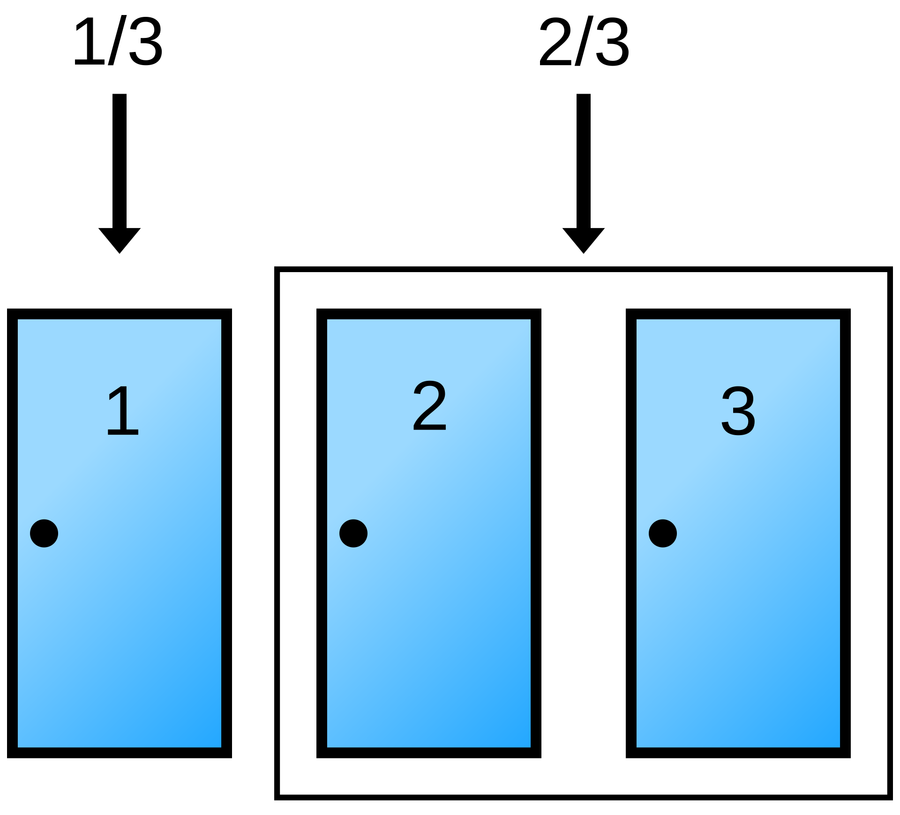
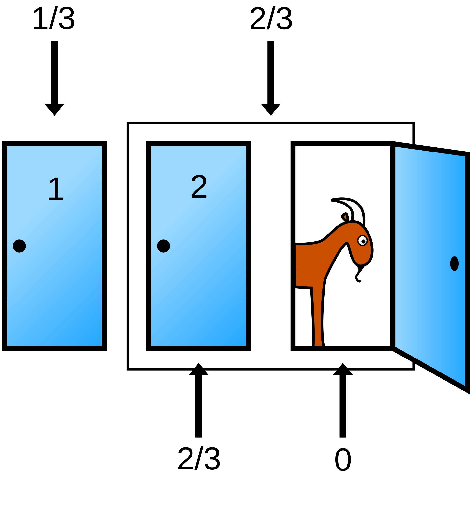




Los métodos de aprendizaje supervisado pueden verse desde dos perspectivas complementarias. En una perspectiva determinista, el objetivo es aprender directamente una función de decisión $f(\mathbf{x})$ que asigne cada observación a una clase, produzca una predicción continua o aproxime una relación funcional. En una perspectiva probabilística, en cambio, el objetivo es modelar explícitamente la incertidumbre: no sólo se decide una clase, sino que se estima qué tan plausible es cada clase dada la evidencia observada. Esto se traduce en que, si no observamos niguna caracteristica del objeto, la mejor decisión que podemos tomar depende de la probabilidad previa de cada clase.
 
Para ilustrar este hecho, supongamos que somos participantes dentro del famoso juego *En familia con chabelo*, donde se nos da la oportunidad de ganar un auto, para esto debemos de escoger dentro de 3 posibles puertas donde detrás se encuentra el auto o una cabra. Si no se nos da ninguna pista previa es razonable pensar que contamos con una probabilidad de $\frac{1}{3}$ de ganar el auto, por lo que la mejor decisión es escoger una puerta al azar. 

{width="65%"}


Asumiendo que nuestra elección es la puerta 1, como sucede en muchas ocasiones el presentador nos hará notar que detras de la puerta tres hay una cabra, con lo cual es natural preguntarse: ¿Bajo que condiciones tendremos la mejor probabilidad de ganar?, es común pensar que dado que sabemos que detrás de las puerta de nuestra elección hay o una cabra o un auto la probabilidad de encntrar nuestro premio tras estas 2 puertas es de $\frac{1}{2}$, sin embargo nuestra intución en ese caso sería incorrecta.

{width="65%"}

Para ver con más detalle por qué conviene cambiar de puerta, hagamos las cuentas paso a paso. Antes de que Chabelo abra una puerta, el auto puede estar en cualquiera de las tres puertas con la misma probabilidad:

$$
P(A_1)=P(A_2)=P(A_3)=\frac{1}{3}
$$

donde $A_i$ significa que el auto está detrás de la puerta $i$.

Ahora bien, Chabelo sabe dónde está el auto y siempre abre una puerta que tiene una cabra. Además, si tiene dos puertas con cabra disponibles, asumimos que escoge una de ellas al azar. Entonces las posibilidades son las siguientes:

Las ramas donde cambiar gana valen por 2 porque tienen probabilidad $\frac{1}{3}$, mientras que las ramas donde cambiar pierde valen $\frac{1}{6}$. Esto ocurre porque si el auto está en nuestra puerta inicial, Chabelo tiene dos puertas posibles para abrir y divide ese caso en dos ramas de probabilidad $\frac{1}{6}$. En cambio, si el auto está en una puerta distinta a la nuestra, Chabelo no tiene libertad: sólo puede abrir la única puerta restante con cabra. Por eso cada una de esas ramas conserva probabilidad $\frac{1}{3}$, equivalente a dos partes de tamaño $\frac{1}{6}$.

| Auto detrás de | Chabelo abre | Probabilidad | Si nos quedamos | Si cambiamos |
|---|---|---:|---|---|
| Puerta 1 | Puerta 2 | $\frac{1}{3}\cdot\frac{1}{2} = \frac{1}{6}$ | gana | pierde |
| Puerta 1 | Puerta 3 | $\frac{1}{3}\cdot\frac{1}{2} = \frac{1}{6}$ | gana | pierde |
| Puerta 2 | Puerta 3 | $\frac{1}{3}\cdot 1 = \frac{1}{3}$ | pierde | gana |
| Puerta 3 | Puerta 2 | $\frac{1}{3}\cdot 1 = \frac{1}{3}$ | pierde | gana |

: Los cuatro caminos posibles cuando elegimos la puerta 1. Quedarse gana con probabilidad 1/6 + 1/6 = 1/3; cambiar, con 1/3 + 1/3 = 2/3. {#tbl-monty-caminos}

::: {.content-visible when-format="html"}
```{=html}
<div class="plab" id="mh-lab">
  <p class="plab-eyebrow">Laboratorio · Teorema de Bayes</p>
  <h3 class="plab-title">¿Conviene cambiar de puerta?</h3>
  <p class="plab-sub">Cada partida se juega dos veces con el mismo auto y la misma elección inicial: una vez quedándose y otra cambiando. El presentador abre todas las puertas con cabra menos una.</p>
  <div class="plab-controls">
    <label>Número de puertas: <b id="mh-n-v"></b><input type="range" id="mh-n" min="3" max="10" step="1" value="3"></label>
    <div class="plab-field">Jugar
      <div style="display:flex;gap:.4rem;flex-wrap:wrap"><button class="plab-btn primary" id="mh-1">1 partida</button><button class="plab-btn" id="mh-100">100</button><button class="plab-btn" id="mh-1000">1000</button><button class="plab-btn" id="mh-reset">Reiniciar</button></div>
    </div>
  </div>
  <div class="plab-stats">
    <div class="plab-stat"><span>Partidas</span><strong id="mh-games"></strong></div>
    <div class="plab-stat"><span>Gana si se queda</span><strong id="mh-stay"></strong></div>
    <div class="plab-stat"><span>Gana si cambia</span><strong id="mh-switch"></strong></div>
    <div class="plab-stat"><span>Teoría: quedarse / cambiar</span><strong id="mh-theory"></strong></div>
  </div>
  <div class="plab-grid">
    <div class="plab-panel"><h4>Última partida</h4><svg id="mh-doors" role="img" aria-label="Puertas de la última partida: elegida, abiertas y la que queda"></svg>
      <div class="plab-legend"><span><i style="background:var(--lab-s1)"></i>elección inicial</span><span><i style="background:var(--lab-axis)"></i>abierta (cabra)</span><span><i style="background:var(--lab-s3)"></i>auto</span></div></div>
    <div class="plab-panel"><h4>Proporción de victorias acumulada</h4><svg id="mh-curve" role="img" aria-label="Frecuencia de victorias de cada estrategia a medida que se juegan partidas"></svg>
      <div class="plab-legend"><span><i style="background:var(--lab-s2)"></i>cambiar</span><span><i style="background:var(--lab-s1)"></i>quedarse</span><span><i style="background:var(--lab-axis)"></i>valores teóricos</span></div></div>
  </div>
  <p class="plab-note" id="mh-note" aria-live="polite"></p>
</div>
<script>
(() => {
  const K = window.LabKit, root = document.getElementById('mh-lab');
  const $ = s => root.querySelector(s);
  let r = K.rng(2026), games = 0, stayW = 0, swW = 0, hist = [], last = null;
  function play() {
    const n = +$('#mh-n').value, car = Math.floor(r() * n), pick = Math.floor(r() * n);
    // El presentador deja cerrada una puerta además de la elegida: el auto si no fue elegido; si no, una al azar.
    let keep = car; if (pick === car) { do { keep = Math.floor(r() * n); } while (keep === pick); }
    games++; if (pick === car) stayW++; if (keep === car) swW++;
    hist.push([games, stayW / games, swW / games]); last = { n, car, pick, keep };
  }
  const reset = () => { r = K.rng(2026); games = stayW = swW = 0; hist = []; last = null; };
  [['#mh-1', 1], ['#mh-100', 100], ['#mh-1000', 1000]].forEach(([id, k]) => $(id).addEventListener('click', () => { for (let i = 0; i < k; i++) play(); render(); }));
  $('#mh-reset').addEventListener('click', () => { reset(); render(); });
  $('#mh-n').addEventListener('input', () => { reset(); render(); });
  function render() {
    const n = +$('#mh-n').value; $('#mh-n-v').textContent = n;
    $('#mh-games').textContent = games;
    $('#mh-stay').textContent = games ? K.fmt(stayW / games, 3) : '—'; $('#mh-switch').textContent = games ? K.fmt(swW / games, 3) : '—';
    $('#mh-theory').textContent = `${K.fmt(1 / n, 3)} / ${K.fmt((n - 1) / n, 3)}`;
    const c = K.chart($('#mh-doors'), { width: 380, height: 170, x: [0, n], y: [0, 1.4], margin: { left: 8, right: 8, top: 8, bottom: 22 } });
    for (let d = 0; d < n; d++) {
      const open = last && d !== last.pick && d !== last.keep, cls = !last ? 'muted' : open ? 'muted' : d === last.pick ? 's1' : 's2';
      const rc = c.rect(d + 0.12, 0.1, d + 0.88, 1.1, cls); rc.style.fillOpacity = open ? 0.12 : 0.28;
      c.text(d + 0.5, 0.6, last ? (d === last.car ? '🚗' : open ? '🐐' : '?') : String(d + 1), { 'text-anchor': 'middle', dy: 5, class: 'strong', style: 'font-size:18px' });
      c.text(d + 0.5, 1.25, last ? (d === last.pick ? 'elegida' : d === last.keep ? 'cambio' : 'abierta') : '', { 'text-anchor': 'middle', style: 'font-size:10px' });
      if (last && d === last.car) { const rr = c.rect(d + 0.1, 0.08, d + 0.9, 1.12, 's3'); rr.style.fill = 'none'; rr.style.strokeWidth = 2.5; }
    }
    const xmax = Math.max(10, games);
    const cc = K.chart($('#mh-curve'), { width: 380, height: 220, x: [1, xmax], y: [0, 1], margin: { left: 40, bottom: 38 } });
    cc.axes({ xTicks: 5, yTicks: 5, xLabel: 'partidas jugadas', yLabel: 'proporción de victorias', xFmt: v => K.fmt(v, 0), yFmt: v => K.fmt(v, 1) });
    cc.line(1, 1 / n, xmax, 1 / n, 'muted line dash thin'); cc.line(1, (n - 1) / n, xmax, (n - 1) / n, 'muted line dash thin');
    if (hist.length) { const step = Math.max(1, Math.floor(hist.length / 400)); const hs = hist.filter((_, k) => k % step === 0 || k === hist.length - 1);
      cc.path(hs.map(h => [h[0], h[1]]), 's1 line'); cc.path(hs.map(h => [h[0], h[2]]), 's2 line'); }
    const note = $('#mh-note');
    if (!games) { note.className = 'plab-note'; note.textContent = 'Antes de jugar: ¿qué estrategia crees que gana más? Juega 1000 partidas y compara con la teoría.'; }
    else { note.className = games >= 200 ? 'plab-note good' : 'plab-note'; note.textContent = `Tras ${games} partidas, cambiar ganó ${swW} veces (${K.fmt(100 * swW / games, 1)} %) y quedarse ${stayW} (${K.fmt(100 * stayW / games, 1)} %). Quedarse solo gana si la primera elección fue correcta, lo que ocurre con probabilidad 1/${n}; en cualquier otro caso, la puerta que el presentador deja cerrada tiene el auto.`; }
  }
  render();
})();
</script>
```
:::

::: {.content-visible when-format="pdf"}
En la versión web, un laboratorio simula el juego con 3 a 10 puertas. Con tres puertas, quedarse gana con probabilidad 1/3 y cambiar con 2/3; con $n$ puertas, $1/n$ y $(n-1)/n$.
:::


Como en el ejemplo Chabelo abre la puerta 3 y muestra una cabra, debemos quedarnos únicamente con los casos compatibles con esa información. Es decir, descartamos todos los casos donde Chabelo abre la puerta 2 o donde el auto estaba detrás de la puerta 3.

Los casos posibles después de observar que Chabelo abrió la puerta 3 son:

| Caso | Ubicación del auto | Probabilidad inicial | Probabilidad de que Chabelo abra la puerta 3 | Probabilidad conjunta |
|---|---:|---:|---:|---:|
| 1 | Puerta 1 | $\frac{1}{3}$ | $\frac{1}{2}$ | $\frac{1}{3}\cdot\frac{1}{2}=\frac{1}{6}$ |
| 2 | Puerta 2 | $\frac{1}{3}$ | $1$ | $\frac{1}{3}\cdot 1=\frac{1}{3}$ |
| 3 | Puerta 3 | $\frac{1}{3}$ | $0$ | $\frac{1}{3}\cdot 0=0$ |

La probabilidad total de que Chabelo abra la puerta 3 es:

$$
P(\text{Chabelo abre puerta 3})
=
\frac{1}{6}+\frac{1}{3}+0
$$

$$
P(\text{Chabelo abre puerta 3})
=
\frac{1}{6}+\frac{2}{6}
=
\frac{3}{6}
=
\frac{1}{2}
$$

Ahora actualizamos las probabilidades usando la información nueva. Primero, calculemos la probabilidad de que el auto esté en la puerta 1 dado que Chabelo abrió la puerta 3:

$$
P(A_1 \mid \text{Chabelo abre puerta 3})
=
\frac{P(A_1 \cap \text{Chabelo abre puerta 3})}
{P(\text{Chabelo abre puerta 3})}
$$

$$
P(A_1 \mid \text{Chabelo abre puerta 3})
=
\frac{\frac{1}{6}}{\frac{1}{2}}
=
\frac{1}{6}\cdot\frac{2}{1}
=
\frac{2}{6}
=
\frac{1}{3}
$$

Por lo tanto, si nos quedamos con la puerta 1, la probabilidad de ganar sigue siendo:

$$
P(\text{ganar si nos quedamos})
=
\frac{1}{3}
$$

Ahora calculemos la probabilidad de que el auto esté en la puerta 2 dado que Chabelo abrió la puerta 3:

$$
P(A_2 \mid \text{Chabelo abre puerta 3})
=
\frac{P(A_2 \cap \text{Chabelo abre puerta 3})}
{P(\text{Chabelo abre puerta 3})}
$$

$$
P(A_2 \mid \text{Chabelo abre puerta 3})
=
\frac{\frac{1}{3}}{\frac{1}{2}}
=
\frac{1}{3}\cdot\frac{2}{1}
=
\frac{2}{3}
$$

Por lo tanto, si cambiamos a la puerta 2, la probabilidad de ganar es:

$$
P(\text{ganar si cambiamos})
=
\frac{2}{3}
$$

La clave está en que la puerta que elegimos inicialmente conserva su probabilidad original de $\frac{1}{3}$. La información nueva no reparte la probabilidad en partes iguales entre las dos puertas cerradas. Más bien, la probabilidad que antes estaba distribuida entre las dos puertas que no escogimos se concentra en la única puerta no abierta por Chabelo.

En resumen:

$$
P(\text{ganar si nos quedamos})
=
\frac{1}{3}
$$

$$
P(\text{ganar si cambiamos})
=
\frac{2}{3}
$$

Así que la mejor estrategia es cambiar de puerta. La pista de Chabelo no es una simple eliminación de una opción: es evidencia nueva que cambia nuestras probabilidades posteriores. Esta es precisamente la idea central del razonamiento bayesiano: actualizar nuestras creencias iniciales cuando observamos nueva información.

::: {.callout-note appearance="minimal"}

En esta simulación podemos observar como las probabilidades del problema a lo largo de las diferentes realizaciones convergen a los valores teóricos de $\frac{1}{3}$ para la estrategia de quedarse y $\frac{2}{3}$ para la estrategia de cambiar.

```{python}
import random
import plotly.graph_objects as go

def simular_monty_hall_plotly(n_simulaciones=10_000):
    puertas = [1, 2, 3]

    gana_quedandose = 0
    gana_cambiando = 0

    probabilidades_quedandose = []
    probabilidades_cambiando = []
    simulaciones = []

    for i in range(1, n_simulaciones + 1):
        # El auto se coloca al azar detrás de una puerta
        puerta_auto = random.choice(puertas)

        # El participante siempre escoge inicialmente la puerta 1
        eleccion_inicial = 1

        # Chabelo abre una puerta que no fue elegida y que no tiene el auto
        puertas_posibles_para_abrir = [
            puerta
            for puerta in puertas
            if puerta != eleccion_inicial and puerta != puerta_auto
        ]

        puerta_abierta = random.choice(puertas_posibles_para_abrir)

        # Si el participante cambia, escoge la única puerta cerrada restante
        puerta_cambio = [
            puerta
            for puerta in puertas
            if puerta != eleccion_inicial and puerta != puerta_abierta
        ][0]

        # Estrategia 1: quedarse con la puerta inicial
        if eleccion_inicial == puerta_auto:
            gana_quedandose += 1

        # Estrategia 2: cambiar de puerta
        if puerta_cambio == puerta_auto:
            gana_cambiando += 1

        # Probabilidades acumuladas hasta la simulación actual
        probabilidades_quedandose.append(gana_quedandose / i)
        probabilidades_cambiando.append(gana_cambiando / i)
        simulaciones.append(i)

    fig = go.Figure()

    fig.add_trace(
        go.Scatter(
            x=simulaciones,
            y=probabilidades_quedandose,
            mode="lines",
            name="Quedarse con la puerta inicial",
            line=dict(color="#1f77b4", width=2)
        )
    )

    fig.add_trace(
        go.Scatter(
            x=simulaciones,
            y=probabilidades_cambiando,
            mode="lines",
            name="Cambiar de puerta",
            line=dict(color="#d62728", width=2)
        )
    )

    fig.add_hline(
        y=1/3,
        line_dash="dash",
        line_color="#1f77b4",
        annotation_text="Valor teórico: 1/3",
        annotation_position="bottom"
    )

    fig.add_hline(
        y=2/3,
        line_dash="dash",
        line_color="#d62728",
        annotation_text="Valor teórico: 2/3",
        annotation_position="bottom"
    )

    fig.update_layout(
    title="Evolución de las probabilidades estimadas en el problema de Monty Hall",
    xaxis_title="Número de simulaciones",
    yaxis_title="Probabilidad acumulada de ganar",
    template="plotly_white",
    yaxis=dict(range=[0, 1]),

    legend=dict(
        title="Estrategia",
        orientation="h",
        yanchor="top",
        y=-0.2,
        xanchor="center",
        x=0.5
    )
)


    fig.show()

    print(f"Simulaciones realizadas: {n_simulaciones}")
    print(f"Probabilidad final de ganar quedándose: {probabilidades_quedandose[-1]:.4f}")
    print(f"Probabilidad final de ganar cambiando: {probabilidades_cambiando[-1]:.4f}")


simular_monty_hall_plotly(n_simulaciones=10_000)

```

:::

Esta es la diferencia central en los clasificadores bayesianos, la decisión se deriva de probabilidades a priori, densidades condicionales y probabilidades posteriores [@duda2001pattern; @bishop2006]. Por ejemplo, si una caja contiene monedas de dos tipos y una de ellas es más frecuente, la decisión con menor probabilidad de error antes de observar la moneda es escoger la clase más probable. Sin embargo, una vez que se observa una característica, como el peso, la decisión debe incorporar esa evidencia. La pregunta deja de ser “¿qué clase es más frecuente?” y pasa a ser “¿qué clase es más probable dado el valor observado?”.

:::{.column-margin}
Si tuvieramos que clasificar entre monedas de un centavo y monedas de diez centavos, antes de observar el peso, la mejor decisión sería escoger la clase más frecuente. Sin embargo, una vez que se observa el peso, la decisión debe incorporar esa evidencia. La pregunta deja de ser “¿qué clase es más frecuente?” y pasa a ser “¿qué clase es más probable dado el valor observado?”.

{width="70%"}
:::

Los clasificadores bayesianos usan el teorema de Bayes para decidir a qué clase pertenece una observación. Para cada clase $\omega_i$, se considera qué tan probable es observar los datos $\mathbf{x}$ si esa clase fuera la correcta, junto con qué tan probable era esa clase antes de ver los datos. Con esta información se calcula la probabilidad de cada clase después de observar $\mathbf{x}$. La decisión más sencilla consiste en elegir la clase con mayor probabilidad posterior; si algunos errores son más costosos que otros, se puede modificar la decisión para tomar en cuenta esos costos [@duda2001pattern; @jaynes2003probability].


Este capítulo desarrolla la clasificación bayesiana desde sus fundamentos hasta algunas variantes prácticas: Naïve Bayes, clasificadores gaussianos, modelos de Markov para secuencias discretas, decisión bayesiana con costos y el criterio minimax cuando las probabilidades previas son inciertas. Los ejemplos computacionales están escritos en Python y buscan conectar la teoría con implementaciones reproducibles.

## Vista probabilística de la clasificación

Sea $\mathbf{x}\in\mathbb{R}^d$ una observación y sea $\Omega=\{\omega_1,\dots,\omega_c\}$ el conjunto de clases posibles. En clasificación probabilística se supone que $\mathbf{x}$ no determina de manera absoluta la clase, sino que modifica nuestras creencias sobre ella. Antes de observar $\mathbf{x}$, la información disponible está representada por las probabilidades previas $P(\omega_i)$. Después de observar $\mathbf{x}$, la información relevante se resume en las probabilidades posteriores $P(\omega_i\mid \mathbf{x})$.

::: {.callout-note appearance="minimal"}
Definición. La probabilidad posterior de la clase $\omega_i$ dada una observación $\mathbf{x}$ se obtiene mediante el teorema de Bayes:
$$
P(\omega_i\mid \mathbf{x}) = \frac{p(\mathbf{x}\mid \omega_i)P(\omega_i)}{p(\mathbf{x})}
$$ {#eq-bayes-posterior}
:::

En la ecuación @eq-bayes-posterior, $p(\mathbf{x}\mid\omega_i)$ es la densidad condicional de la observación bajo la clase $\omega_i$, $P(\omega_i)$ es la probabilidad previa de esa clase y $p(\mathbf{x})$ es la densidad marginal de la observación:

$$
p(\mathbf{x}) = \sum_{j=1}^c p(\mathbf{x}\mid\omega_j)P(\omega_j).
$$

Como $p(\mathbf{x})$ no depende de la clase que se compara, muchas reglas de decisión pueden escribirse en términos de la cantidad no normalizada $p(\mathbf{x}\mid\omega_i)P(\omega_i)$.

**La decisión de clasificación.**

Si no hay observaciones, una regla razonable para dos clases es escoger la clase más probable a priori:

$$
\text{decidir }\omega_1 \quad \text{si} \quad P(\omega_1)>P(\omega_2).
$$

El error esperado de esta regla, cuando sólo existen dos clases, es

$$
P(e)=\min\{P(\omega_1),P(\omega_2)\}.
$$

Una vez observada $\mathbf{x}$, la decisión cambia: se debe comparar $P(\omega_1\mid\mathbf{x})$ contra $P(\omega_2\mid\mathbf{x})$. Esta distinción es la esencia de la clasificación bayesiana: la evidencia observada actualiza las probabilidades de las clases.

::: {.callout-note appearance="minimal"}
Definición. La regla de máxima probabilidad posterior, o regla MAP, asigna la observación $\mathbf{x}$ a la clase con posterior máxima:
$$
\hat{\omega}(\mathbf{x}) = \arg\max_{\omega_i\in\Omega} P(\omega_i\mid\mathbf{x})
$$ {#eq-map-rule}
:::

### Ejemplo básico: El dilema del Cine


::: columns
::: {.column width="55%"}

**Esta persona dejó caer su boleto en el pasillo.**

¿Le dices?

> “Disculpe, señora”

o

> “Disculpe, señor”

**Tienes que hacer una conjetura.**

:::

::: {.column width="45%"}

{width="70%"}

:::
:::

Para responder de la manera mas acertada posible podemos hacer uso del teorema de Bayes, para esto definamos el evento $H$ como “hombre” y el evento $M$ como “mujer”, mientras que la evidencia observada es el tipo de cabello de la persona. Entonces, la probabilidad de que la persona sea hombre o mujer dado el tipo de cabello se calcula con Bayes:

$$
P(\text{sexo}\mid \text{cabello})
=
\frac{
P(\text{cabello}\mid \text{sexo})P(\text{sexo})
}{
\sum_{\text{sexo}} P(\text{sexo})P(\text{cabello}\mid \text{sexo})
}
$$

Donde bajo una asumpción justa podemos suponer que dentro del cine:

::: columns
::: {.column width="50%"}

**De cada 100 mujeres en el cine**

- 50 tienen cabello corto
- 50 tienen cabello largo

:::

::: {.column width="50%"}

**De cada 100 hombres en el cine**

- 96 tienen cabello corto
- 4 tienen cabello largo

:::
:::

Hagamos los calculos paso a paso, si asumimos que la proporción de hombres y mujeres en el cine es la misma, entonces las probabilidades previas son:

$$P(H)=P(M)=0.5$$

Mientras que las verosimilitudes son:
$$P(\text{cabello largo}\mid H)=0.04$$
$$P(\text{cabello largo}\mid M)=0.50$$

teniendo esto, Entonces los numeradores son:

$$
P(\text{largo}\mid H)P(H)=0.04(0.5)=0.02
$$
$$
P(\text{largo}\mid M)P(M)=0.50(0.5)=0.25
$$

Entonces:

$$
P(H\mid \text{cabello largo}) = 0.02A \approx 0.07
$$

$$
P(M\mid \text{cabello largo}) = 0.25A \approx 0.93
$$

donde

$$
A=\frac{1}{0.02+0.25}
$$

Así, bajo la regla de máxima probabilidad posterior, la decisión es:

$$
\Rightarrow \textbf{Decisión: mujer}
$$

::: {.callout-note}
La idea central es que no decidimos solo por la característica observada, sino por cómo esa característica modifica nuestras creencias previas sobre cada clase.
:::

### Dilema en el cine: el contexto importa

Es importante notar que la decisión anterior depende de las probabilidades previas. Si el contexto cambia, las probabilidades previas también cambian, lo que puede llevar a una decisión diferente incluso con la misma evidencia observada. Por ejemplo, si esta situación ocurre mientras estás formado en la fila del baño de hombres, la proporción de hombres y mujeres cambia drásticamente, lo que afecta las probabilidades previas y, por ende, la decisión bayesiana.

::: columns

::: {.column width="50%"}

¿Le dices?

> “Disculpe, señora”

o

> “Disculpe, señor”

:::

::: {.column width="50%"}


{width="80%"}
:::

:::

Ahora las probabilidades previas cambian:

$$
P(H)=0.98,
\qquad
P(M)=0.02
$$

donde $H$ representa “hombre” y $M$ representa “mujer”. De nuevo asumiendo de manera justa que dentro de la fila:

::: columns

::: {.column width="50%"}

**De cada 2 mujeres en la fila**

- 1 tiene cabello corto
- 1 tiene cabello largo

:::

::: {.column width="50%"}

**De cada 98 hombres en la fila**

- 94 tienen cabello corto
- 4 tienen cabello largo

:::

:::


De los datos anteriores:

$$
P(\text{cabello largo}\mid H)=\frac{4}{98}
$$

$$
P(\text{cabello largo}\mid M)=\frac{1}{2}
$$

Calculamos los numeradores de Bayes:

$$
P(\text{cabello largo}\mid H)P(H)
=
\frac{4}{98}(0.98)
=
0.04
$$

$$
P(\text{cabello largo}\mid M)P(M)
=
\frac{1}{2}(0.02)
=
0.01
$$

La constante de normalización es:

$$
B=
\frac{1}{0.04+0.01}
=
20
$$

Entonces, bajo la misma regla de máxima probabilidad posterior, las probabilidades posteriores son:

$$
P(H\mid \text{cabello largo})
=
0.04B
=
0.04(20)
=
0.80
$$

$$
P(M\mid \text{cabello largo})
=
0.01B
=
0.01(20)
=
0.20
$$

Como:

$$
P(H\mid \text{cabello largo})
>
P(M\mid \text{cabello largo})
$$

la decisión bayesiana es:

$$
\Rightarrow \textbf{Decisión: hombre}
$$

::: {.callout-important}
La misma evidencia observada (cabello largo) puede llevar a una decisión distinta cuando cambian las probabilidades previas.

En clasificación bayesiana, el contexto modifica la inferencia.
:::


### Implementación básica: algoritmo general de un clasificador bayesiano

A continuación se muestra una implementación básica de un clasificador bayesiano para cualquier número de clases. El código calcula las probabilidades posteriores y toma la decisión de clasificación basada en la clase con mayor probabilidad posterior.

```{python}
#| echo: true
#| code-fold: false
import numpy as np

def clasificador_bayesiano(verosimilitudes, priors, clases):
    """
    Clasificador bayesiano para cualquier número de clases.

    verosimilitudes: p(x | omega_i) para cada clase.
    priors: P(omega_i) para cada clase.
    clases: nombres de las clases.
    """
    verosimilitudes = np.array(verosimilitudes, dtype=float)
    priors = np.array(priors, dtype=float)
    clases = np.array(clases)

    evidencia = np.sum(verosimilitudes * priors)
    posteriores = (verosimilitudes * priors) / evidencia

    indice_decision = np.argmax(posteriores)
    decision = clases[indice_decision]

    return posteriores, decision


clases = ["normal", "enfermedad"]

# p(x | omega_i): qué tan probable es observar x en cada clase
verosimilitudes = [0.2, 0.4]

# P(omega_i): probabilidad previa de cada clase
priors = [0.9, 0.1]

posteriores, decision = clasificador_bayesiano(
    verosimilitudes,
    priors,
    clases
)

for clase, posterior in zip(clases, posteriores):
    print(f"P({clase} | x) = {posterior:.3f}")

print("Decisión:", decision)
```

En este ejemplo, aunque la verosimilitud bajo la clase de enfermedad es mayor, el prior de la clase normal domina la decisión de error mínimo. Esto ilustra una idea importante: una evidencia local no se interpreta de manera aislada, sino en relación con la frecuencia previa de cada clase.

::: {.content-visible when-format="html"}
```{=html}
<div class="plab" id="cine-lab">
  <p class="plab-eyebrow">Laboratorio · Prior y posterior</p>
  <h3 class="plab-title">¿Señora o señor? Depende de dónde estés</h3>
  <p class="plab-sub">La evidencia es «cabello largo». Mueve la probabilidad previa de cada clase y las verosimilitudes, y observa cómo cambia la posterior.</p>
  <div class="plab-controls">
    <label>P(H) previa: <b id="cine-p-v"></b><input type="range" id="cine-p" min="0.01" max="0.99" step="0.01" value="0.5"></label>
    <label>P(largo | H): <b id="cine-lh-v"></b><input type="range" id="cine-lh" min="0.01" max="0.99" step="0.01" value="0.04"></label>
    <label>P(largo | M): <b id="cine-lm-v"></b><input type="range" id="cine-lm" min="0.01" max="0.99" step="0.01" value="0.5"></label>
    <div class="plab-field">Contexto
      <div style="display:flex;gap:.4rem;flex-wrap:wrap"><button class="plab-btn" id="cine-sala">Sala de cine (0.50)</button><button class="plab-btn" id="cine-fila">Fila del baño de hombres (0.98)</button></div>
    </div>
  </div>
  <div class="plab-stats">
    <div class="plab-stat"><span>P(largo | H)·P(H)</span><strong id="cine-jh"></strong></div>
    <div class="plab-stat"><span>P(largo | M)·P(M)</span><strong id="cine-jm"></strong></div>
    <div class="plab-stat"><span>P(H | largo)</span><strong id="cine-ph"></strong></div>
    <div class="plab-stat"><span>Decisión (MAP)</span><strong id="cine-dec"></strong></div>
  </div>
  <div class="plab-panel"><h4>De la previa a la posterior</h4><svg id="cine-svg" class="wide" role="img" aria-label="Barras de probabilidad previa, conjunta y posterior de cada clase"></svg>
    <div class="plab-legend"><span><i style="background:var(--lab-s1)"></i>hombre (H)</span><span><i style="background:var(--lab-s2)"></i>mujer (M)</span></div></div>
  <p class="plab-note" id="cine-note" aria-live="polite"></p>
</div>
<script>
(() => {
  const K = window.LabKit, root = document.getElementById('cine-lab');
  const $ = s => root.querySelector(s);
  function render() {
    const p = +$('#cine-p').value, lh = +$('#cine-lh').value, lm = +$('#cine-lm').value;
    $('#cine-p-v').textContent = K.fmt(p, 2); $('#cine-lh-v').textContent = K.fmt(lh, 2); $('#cine-lm-v').textContent = K.fmt(lm, 2);
    const jh = lh * p, jm = lm * (1 - p), ph = jh / (jh + jm);
    $('#cine-jh').textContent = K.fmt(jh, 4); $('#cine-jm').textContent = K.fmt(jm, 4); $('#cine-ph').textContent = K.fmt(ph, 3);
    $('#cine-dec').textContent = ph >= 0.5 ? '«Disculpe, señor»' : '«Disculpe, señora»';
    const c = K.chart($('#cine-svg'), { width: 640, height: 230, x: [0, 9], y: [0, 1], margin: { left: 40, bottom: 40, right: 10 } });
    c.axes({ xTicks: 0, yTicks: 5, yLabel: 'probabilidad', xCats: [[1.5, 'previa'], [4.5, 'conjunta P(largo, clase)'], [7.5, 'posterior P(clase | largo)']], yFmt: v => K.fmt(v, 1) });
    const bar = (x, v, cl) => { const rc = c.rect(x, 0, x + 0.9, v, cl); rc.style.fillOpacity = 0.6; c.text(x + 0.45, v, K.fmt(v, 3), { 'text-anchor': 'middle', dy: -4, class: 'strong' }); };
    bar(0.6, p, 's1'); bar(1.5, 1 - p, 's2'); bar(3.6, jh, 's1'); bar(4.5, jm, 's2'); bar(6.6, ph, 's1'); bar(7.5, 1 - ph, 's2');
    const note = $('#cine-note');
    note.className = 'plab-note';
    note.textContent = `La evidencia multiplica la previa de cada clase por su verosimilitud: ${K.fmt(p, 2)}·${K.fmt(lh, 2)} = ${K.fmt(jh, 4)} frente a ${K.fmt(1 - p, 2)}·${K.fmt(lm, 2)} = ${K.fmt(jm, 4)}. Normalizando, P(H | largo) = ${K.fmt(ph, 3)}. ` +
      (p > 0.9 && ph >= 0.5 ? 'Con una previa tan alta, ni siquiera una evidencia que favorece mucho a «mujer» cambia la decisión.' : 'El cociente de verosimilitudes, ' + K.fmt(lm / lh, 1) + ' a 1 a favor de «mujer», es lo que la evidencia aporta.');
  }
  $('#cine-sala').addEventListener('click', () => { $('#cine-p').value = 0.5; render(); });
  $('#cine-fila').addEventListener('click', () => { $('#cine-p').value = 0.98; render(); });
  root.querySelectorAll('input[type=range]').forEach(el => el.addEventListener('input', render));
  render();
})();
</script>
```
:::

::: {.content-visible when-format="pdf"}
En la versión web, un laboratorio recalcula la posterior al mover la previa y las verosimilitudes. Con $P(H) = 0.5$, $P(\text{largo} \mid H) = 0.04$ y $P(\text{largo} \mid M) = 0.5$ se obtiene $P(H \mid \text{largo}) = 0.074$; en la fila del baño de hombres, con $P(H) = 0.98$, la posterior sube a $0.80$ y la decisión cambia a «señor».
:::


## Clasificador bayesiano de error mínimo

La regla MAP tiene una interpretación óptima cuando todos los errores tienen el mismo costo: minimiza la probabilidad promedio de clasificación incorrecta. Para verlo, consideremos inicialmente dos clases. Si se asigna $\mathbf{x}$ a $\omega_1$, el error condicional es $P(\omega_2\mid\mathbf{x})$; si se asigna a $\omega_2$, el error condicional es $P(\omega_1\mid\mathbf{x})$. Por tanto, para minimizar el error en cada punto $\mathbf{x}$ se elige la clase con mayor posterior.

::: {.callout-note appearance="minimal"}
Definición. El error condicional de clasificación para dos clases es
$$
P(e\mid\mathbf{x})=
\begin{cases}
P(\omega_2\mid\mathbf{x}), & \text{si se decide }\omega_1,\\
P(\omega_1\mid\mathbf{x}), & \text{si se decide }\omega_2.
\end{cases}
$$ {#eq-conditional-error}
:::

El error promedio se obtiene integrando sobre todo el espacio de observaciones:

$$
P(e)=\int P(e\mid\mathbf{x})p(\mathbf{x})\,d\mathbf{x}.
$$

Dado que $p(\mathbf{x})\geq 0$, minimizar el error promedio se logra minimizando el error condicional punto a punto. Así, para dos clases:

$$
P(\omega_1\mid\mathbf{x})>P(\omega_2\mid\mathbf{x})
\quad \Longrightarrow \quad
\mathbf{x}\in\omega_1.
$$

### Ejemplo en Python: decisión de error mínimo

El siguiente código muestra la regla de error mínimo para varias observaciones. Para cada observación se tienen las verosimilitudes $p(\mathbf{x}\mid\omega_i)$ bajo dos clases. Después se calculan las posteriores, se elige la clase con mayor posterior y se reporta el error condicional mínimo.

```{python}
#| code-fold: false
import numpy as np

clases = np.array(["normal", "enfermedad"])

# Probabilidades previas P(omega_i)
priors = np.array([0.8, 0.2])

# Cada fila representa una observación distinta.
# Las columnas contienen p(x | normal) y p(x | enfermedad).
verosimilitudes = np.array([
    [0.50, 0.10],
    [0.35, 0.25],
    [0.20, 0.45],
    [0.10, 0.60],
    [0.40, 0.30]
])

# Numerador de Bayes: p(x | omega_i) P(omega_i)
puntajes_no_normalizados = verosimilitudes * priors

# Evidencia p(x), calculada para cada observación
evidencia = puntajes_no_normalizados.sum(axis=1, keepdims=True)

# Posteriores P(omega_i | x)
posteriores = puntajes_no_normalizados / evidencia

# Regla de error mínimo: elegir la clase con mayor posterior
indices_decision = np.argmax(posteriores, axis=1)
decisiones = clases[indices_decision]

# El error condicional mínimo es 1 menos la posterior más grande
errores_condicionales = 1 - np.max(posteriores, axis=1)

for i, (post, decision, error) in enumerate(
    zip(posteriores, decisiones, errores_condicionales),
    start=1
):
    print(f"Observación {i}")
    print(f"  P(normal | x) = {post[0]:.3f}")
    print(f"  P(enfermedad | x) = {post[1]:.3f}")
    print(f"  Decisión de error mínimo: {decision}")
    print(f"  Error condicional mínimo: {error:.3f}\n")
```

En este ejemplo, una observación se clasifica como `enfermedad` sólo cuando su posterior supera a la posterior de `normal`. No basta con que $p(\mathbf{x}\mid\text{enfermedad})$ sea grande de manera aislada: también importa el prior de cada clase. Por eso la decisión se basa en el producto $p(\mathbf{x}\mid\omega_i)P(\omega_i)$ y no únicamente en la verosimilitud.

### Formas equivalentes de la regla de decisión

Usando el teorema de Bayes, la comparación de posteriores puede escribirse como una comparación de productos entre verosimilitud y prior:

$$
p(\mathbf{x}\mid\omega_1)P(\omega_1) > p(\mathbf{x}\mid\omega_2)P(\omega_2).
$$

Para dos clases, también puede expresarse mediante el cociente de verosimilitudes.

::: {.callout-note appearance="minimal"}
Definición. El cociente de verosimilitudes entre dos clases se define como
$$
\ell(\mathbf{x})=\frac{p(\mathbf{x}\mid\omega_1)}{p(\mathbf{x}\mid\omega_2)}
$$ {#eq-likelihood-ratio}
:::

La regla de decisión se vuelve

$$
\ell(\mathbf{x}) \gtrless_{\omega_2}^{\omega_1} \frac{P(\omega_2)}{P(\omega_1)}.
$$

Si se trabaja en escala logarítmica, se evita el subdesbordamiento numérico y se transforman productos en sumas:

$$
\log \ell(\mathbf{x}) = \log p(\mathbf{x}\mid\omega_1)-\log p(\mathbf{x}\mid\omega_2).
$$

Esta forma es especialmente útil en alta dimensión, en secuencias largas y en modelos donde las densidades son productos de muchas probabilidades pequeñas.


## Clasificador Naïve Bayes

En alta dimensión, estimar la densidad conjunta $p(\mathbf{x}\mid\omega_i)$ puede ser difícil. Si $\mathbf{x}=(x_1,\dots,x_d)$, una densidad conjunta general requiere modelar dependencias entre todas las variables. Por ejemplo, en clasificación de textos no basta con preguntar si aparece una palabra: un documento puede contener cientos o miles de términos, y cada término puede aparecer varias veces.

Naïve Bayes simplifica el problema suponiendo independencia condicional de las características dada la clase [@mccallum1998comparison; @murphy2012]. La palabra *naïve* no significa que el método sea inútil, sino que usa una suposición fuerte: una vez que conocemos la clase, tratamos a las características como si aportaran evidencia de manera separada.

::: {.callout-note appearance="minimal"}
Definición. El supuesto de independencia condicional de Naïve Bayes establece que
$$
p(\mathbf{x}\mid\omega_i)=p(x_1,x_2,\dots,x_d\mid\omega_i)=\prod_{k=1}^{d}p(x_k\mid\omega_i)
$$ {#eq-naive-bayes-assumption}
:::

Con este supuesto, la regla MAP se escribe como:

$$
\hat{\omega}(\mathbf{x})=\arg\max_i \left[\log P(\omega_i)+\sum_{k=1}^{d}\log p(x_k\mid\omega_i)\right].
$$

Esta expresión tiene una lectura sencilla. El término $\log P(\omega_i)$ representa qué tan probable era la clase antes de observar el documento. La suma $\sum_{k=1}^{d}\log p(x_k\mid\omega_i)$ acumula la evidencia que aportan las características observadas. La clase elegida es aquella que obtiene la puntuación total más alta.

```{python}
#| label: fig-nb-independencia
#| fig-cap: "Comparación geométrica entre el supuesto gaussiano general (QDA, covarianza completa) y Naïve Bayes gaussiano (covarianza diagonal). QDA permite elipses rotadas arbitrariamente; NB solo puede representar elipses alineadas con los ejes."
#| code-fold: true

import numpy as np
import plotly.graph_objects as go
from plotly.subplots import make_subplots

rng = np.random.default_rng(7)

# Datos con correlación entre variables
cov_full = np.array([[1.2, 0.85], [0.85, 0.9]])
cov_diag = np.diag(np.diag(cov_full))  # versión diagonal (NB)

mu1 = np.array([-1.5, -1.0])
mu2 = np.array([1.5,  1.0])

X1 = rng.multivariate_normal(mu1, cov_full, 80)
X2 = rng.multivariate_normal(mu2, cov_full, 80)

def ellipse_points(mu, cov, n_std=2, n_pts=120):
    """Elipse de confianza via descomposición espectral."""
    vals, vecs = np.linalg.eigh(cov)
    t = np.linspace(0, 2 * np.pi, n_pts)
    circle = np.stack([np.cos(t), np.sin(t)], axis=1)
    ellipse = circle @ (vecs * np.sqrt(vals) * n_std).T + mu
    return ellipse[:, 0], ellipse[:, 1]

def grid_posterior(X1, X2, cov, xlim, ylim, n=80):
    """Probabilidad posterior P(clase 1 | x) en un grid 2D."""
    def mvn(X, mu, cov):
        D = X.shape[1]
        diff = X - mu
        inv_cov = np.linalg.inv(cov)
        sign, logdet = np.linalg.slogdet(cov)
        maha = np.einsum('ij,jk,ik->i', diff, inv_cov, diff)
        return np.exp(-0.5 * maha - 0.5 * (D * np.log(2 * np.pi) + logdet))

    xg = np.linspace(xlim[0], xlim[1], n)
    yg = np.linspace(ylim[0], ylim[1], n)
    Xg, Yg = np.meshgrid(xg, yg)
    pts = np.c_[Xg.ravel(), Yg.ravel()]

    mu1_ = X1.mean(axis=0)
    mu2_ = X2.mean(axis=0)
    p1 = mvn(pts, mu1_, cov)
    p2 = mvn(pts, mu2_, cov)
    post = p1 / (p1 + p2 + 1e-300)
    return xg, yg, post.reshape(n, n)

xlim = (-5, 5); ylim = (-5, 5)
xg, yg, Z_full = grid_posterior(X1, X2, cov_full, xlim, ylim)
xg, yg, Z_diag = grid_posterior(X1, X2, cov_diag, xlim, ylim)

mu1_est = X1.mean(axis=0)
mu2_est = X2.mean(axis=0)

fig = make_subplots(
    rows=1, cols=2,
    subplot_titles=["QDA (covarianza completa)", "Naïve Bayes (covarianza diagonal)"]
)

for col, cov, Z, title in [(1, cov_full, Z_full, "QDA"), (2, cov_diag, Z_diag, "NB")]:
    fig.add_trace(go.Contour(
        x=xg, y=yg, z=Z,
        colorscale=[[0, "#4C72B0"], [0.5, "white"], [1, "#DD8452"]],
        opacity=0.40,
        showscale=False,
        contours=dict(showlines=True, start=0.1, end=0.9, size=0.2,
                      coloring="fill")
    ), row=1, col=col)

    for X, mu_e, c_col, name in [
        (X1, mu1_est, "#2563eb", "Clase 1"),
        (X2, mu2_est, "#dc2626", "Clase 2")
    ]:
        fig.add_trace(go.Scatter(
            x=X[:, 0], y=X[:, 1],
            mode="markers",
            marker=dict(color=c_col, size=5, opacity=0.55),
            name=name, showlegend=(col == 1)
        ), row=1, col=col)

        ex, ey = ellipse_points(mu_e, cov if col == 1 else np.diag(np.diag(cov_full)))
        fig.add_trace(go.Scatter(
            x=ex, y=ey, mode="lines",
            line=dict(color=c_col, width=2.2, dash="solid"),
            showlegend=False
        ), row=1, col=col)

fig.update_layout(
    title="Supuesto de independencia condicional: QDA vs Naïve Bayes",
    template="plotly_white",
    height=420,
    legend=dict(orientation="h", yanchor="bottom", y=1.08, xanchor="right", x=1)
)
fig.update_xaxes(range=xlim, title_text="x₁")
fig.update_yaxes(range=ylim, title_text="x₂")
fig.show()
```

### Ejemplo manual con atributos categóricos

Volvamos a los quince días de béisbol del capítulo de árboles de decisión. Queremos decidir si se juega un día **soleado, fresco, con humedad alta y viento fuerte**. Naive Bayes solo necesita contar.

**Paso 1. Previas.** De 15 días, 9 se jugó y 6 no: $P(\text{Sí}) = 9/15 = 0.6$ y $P(\text{No}) = 6/15 = 0.4$.

**Paso 2. Verosimilitudes de cada atributo dentro de cada clase.**

| Atributo = valor | Conteo en «Sí» (9 días) | $P(\cdot \mid \text{Sí})$ | Conteo en «No» (6 días) | $P(\cdot \mid \text{No})$ |
|---|---:|---:|---:|---:|
| Pronóstico = Soleado | 2 | 2/9 | 4 | 4/6 |
| Temperatura = Fresco | 3 | 3/9 | 2 | 2/6 |
| Humedad = Alta | 3 | 3/9 | 5 | 5/6 |
| Viento = Fuerte | 2 | 2/9 | 3 | 3/6 |

: Conteos por clase para el día nuevo. {#tbl-nb-conteos}

**Paso 3. Multiplicar (suponiendo independencia condicional).**

$$
\begin{aligned}
P(\text{Sí})\prod_j P(x_j \mid \text{Sí}) &= 0.6 \cdot \tfrac{2}{9}\cdot\tfrac{3}{9}\cdot\tfrac{3}{9}\cdot\tfrac{2}{9} = 0.6 \cdot 0.00549 = 0.00329,\\
P(\text{No})\prod_j P(x_j \mid \text{No}) &= 0.4 \cdot \tfrac{4}{6}\cdot\tfrac{2}{6}\cdot\tfrac{5}{6}\cdot\tfrac{3}{6} = 0.4 \cdot 0.0926 = 0.0370.
\end{aligned}
$$

**Paso 4. Normalizar.** $P(\text{No} \mid \mathbf{x}) = 0.0370/(0.0370 + 0.00329) = 0.918$. Se predice **No**.

**El problema de la frecuencia cero.** Si el día nuevo fuera *nublado*, la verosimilitud $P(\text{Nublado} \mid \text{No}) = 0/6$ anularía todo el producto de la clase «No», sin importar lo que digan los demás atributos. El **suavizado de Laplace** suma $\alpha$ (habitualmente 1) a cada conteo:

$$
\hat{P}(x_j = v \mid c) = \frac{n_{v,c} + \alpha}{n_c + \alpha\,|V_j|},
$$ {#eq-laplace}

donde $|V_j|$ es el número de valores posibles del atributo. Con $\alpha = 1$, $P(\text{Nublado} \mid \text{No}) = (0 + 1)/(6 + 3) = 0.111$: improbable, pero no imposible.

::: {.content-visible when-format="html"}
```{=html}
<div class="plab" id="nb-lab">
  <p class="plab-eyebrow">Laboratorio · Naive Bayes</p>
  <h3 class="plab-title">¿Se juega? Contar, multiplicar y normalizar</h3>
  <p class="plab-sub">Elige el día nuevo (o deja un atributo sin observar) y el suavizado α. La tabla muestra cada factor del producto.</p>
  <div class="plab-controls" id="nb-sel"></div>
  <div class="plab-controls"><label>Suavizado de Laplace α: <b id="nb-a-v"></b><input type="range" id="nb-a" min="0" max="3" step="0.1" value="0"></label></div>
  <div class="plab-stats">
    <div class="plab-stat"><span>Producto «Sí»</span><strong id="nb-ps"></strong></div>
    <div class="plab-stat"><span>Producto «No»</span><strong id="nb-pn"></strong></div>
    <div class="plab-stat"><span>P(Sí | día)</span><strong id="nb-post"></strong></div>
    <div class="plab-stat"><span>Predicción</span><strong id="nb-pred"></strong></div>
  </div>
  <div class="plab-grid">
    <div class="plab-panel"><h4>Factores del producto</h4><div id="nb-tab" class="plab-scroll"></div></div>
    <div class="plab-panel"><h4>Evidencia acumulada (log-odds Sí : No)</h4><svg id="nb-svg" role="img" aria-label="Contribución de la previa y de cada atributo al log-odds a favor de jugar"></svg>
      <div class="plab-legend"><span><i style="background:var(--lab-s1)"></i>a favor de «Sí»</span><span><i style="background:var(--lab-s2)"></i>a favor de «No»</span></div></div>
  </div>
  <p class="plab-note" id="nb-note" aria-live="polite"></p>
</div>
<script>
(() => {
  const K = window.LabKit, root = document.getElementById('nb-lab');
  const $ = s => root.querySelector(s);
  const ATTR = ['Pronóstico', 'Temperatura', 'Humedad', 'Viento'];
  const VAL = { 'Pronóstico': ['Soleado', 'Nublado', 'Lluvia'], 'Temperatura': ['Caluroso', 'Templado', 'Fresco'], 'Humedad': ['Alta', 'Normal'], 'Viento': ['Débil', 'Fuerte'] };
  const ROWS = [['Soleado','Caluroso','Alta','Débil','No'],['Soleado','Caluroso','Alta','Fuerte','No'],['Nublado','Caluroso','Alta','Débil','Sí'],['Lluvia','Templado','Alta','Débil','Sí'],
    ['Lluvia','Fresco','Normal','Débil','Sí'],['Lluvia','Fresco','Normal','Fuerte','No'],['Nublado','Fresco','Normal','Fuerte','Sí'],['Soleado','Templado','Alta','Débil','No'],
    ['Soleado','Fresco','Normal','Débil','Sí'],['Lluvia','Templado','Normal','Débil','Sí'],['Soleado','Templado','Normal','Débil','Sí'],['Nublado','Templado','Alta','Fuerte','Sí'],
    ['Nublado','Caluroso','Normal','Débil','Sí'],['Lluvia','Templado','Alta','Fuerte','No'],['Soleado','Fresco','Alta','Débil','No']];
  const INIT = { 'Pronóstico': 'Soleado', 'Temperatura': 'Fresco', 'Humedad': 'Alta', 'Viento': 'Fuerte' };
  $('#nb-sel').innerHTML = ATTR.map(a => `<label>${a}<select data-a="${a}"><option value="">(no observado)</option>${VAL[a].map(v => `<option${v === INIT[a] ? ' selected' : ''}>${v}</option>`).join('')}</select></label>`).join('');
  function render() {
    const al = +$('#nb-a').value; $('#nb-a-v').textContent = K.fmt(al, 1);
    const nS = ROWS.filter(r => r[4] === 'Sí').length, nN = ROWS.length - nS;
    let ps = nS / ROWS.length, pn = nN / ROWS.length; const rows = [['Previa', `${nS}/15`, ps, `${nN}/15`, pn]], contrib = [['previa', Math.log(ps / pn)]];
    ATTR.forEach((a, j) => { const v = $(`select[data-a="${a}"]`).value; if (!v) return;
      const cS = ROWS.filter(r => r[4] === 'Sí' && r[j] === v).length, cN = ROWS.filter(r => r[4] === 'No' && r[j] === v).length, k = VAL[a].length;
      const fS = (cS + al) / (nS + al * k), fN = (cN + al) / (nN + al * k); ps *= fS; pn *= fN;
      rows.push([`${a} = ${v}`, al ? `(${cS}+${K.fmt(al, 1)})/(${nS}+${K.fmt(al * k, 1)})` : `${cS}/${nS}`, fS, al ? `(${cN}+${K.fmt(al, 1)})/(${nN}+${K.fmt(al * k, 1)})` : `${cN}/${nN}`, fN]);
      contrib.push([v, Math.log(fS / fN)]); });
    const tot = ps + pn, post = tot > 0 ? ps / tot : NaN;
    $('#nb-ps').textContent = K.fmt(ps, 5); $('#nb-pn').textContent = K.fmt(pn, 5);
    $('#nb-post').textContent = K.fmt(post, 3); $('#nb-pred').textContent = Number.isNaN(post) ? 'indefinida' : post >= 0.5 ? 'Sí' : 'No';
    $('#nb-tab').innerHTML = '<table class="plab-table"><thead><tr><th>Factor</th><th>Sí</th><th></th><th>No</th><th></th></tr></thead><tbody>' +
      rows.map(r => `<tr><td>${r[0]}</td><td>${r[1]}</td><td${r[2] === 0 ? ' class="hl"' : ''}>${K.fmt(r[2], 3)}</td><td>${r[3]}</td><td${r[4] === 0 ? ' class="hl"' : ''}>${K.fmt(r[4], 3)}</td></tr>`).join('') + '</tbody></table>';
    const fin = contrib.map(c => Number.isFinite(c[1]) ? c[1] : Math.sign(c[1]) * 6), lim = Math.max(2, ...fin.map(Math.abs)) * 1.15;
    const c = K.chart($('#nb-svg'), { width: 380, height: 40 + 34 * contrib.length, x: [-lim, lim], y: [contrib.length, 0], margin: { left: 90, bottom: 34, right: 10, top: 6 } });
    c.axes({ xTicks: 5, yTicks: 0, xLabel: 'ln P(·|Sí)/P(·|No)', xFmt: v => K.fmt(v, 1), grid: true });
    c.line(0, 0, 0, contrib.length, 'muted line');
    contrib.forEach((cc, i) => { const v = fin[i], rc = c.rect(0, i + 0.2, v, i + 0.8, v >= 0 ? 's1' : 's2'); rc.style.fillOpacity = 0.6;
      c.text(-lim, i + 0.5, cc[0], { dx: -6, dy: 4, 'text-anchor': 'end', class: 'strong' }); c.text(v, i + 0.5, Number.isFinite(cc[1]) ? K.fmt(cc[1], 2) : (cc[1] > 0 ? '+∞' : '−∞'), { dx: v >= 0 ? 4 : -4, dy: 4, 'text-anchor': v >= 0 ? 'start' : 'end' }); });
    const note = $('#nb-note');
    if (rows.some(r => r[2] === 0 || r[4] === 0)) { note.className = 'plab-note bad'; note.textContent = 'Un conteo es cero: esa clase queda con probabilidad 0 sin importar los demás atributos. Sube α para suavizar.'; }
    else { note.className = 'plab-note'; note.textContent = `Los log-odds se suman: la previa aporta ${K.fmt(contrib[0][1], 2)} y cada atributo su propio término. Total ${K.fmt(Math.log(ps / pn), 2)} ⇒ P(Sí | día) = ${K.fmt(post, 3)}.`; }
  }
  root.querySelectorAll('select, input[type=range]').forEach(el => el.addEventListener('input', render));
  render();
})();
</script>
```
:::

::: {.content-visible when-format="pdf"}
En la versión web, un laboratorio calcula Naive Bayes con los quince días para cualquier combinación de atributos y suavizado. Con el día soleado, fresco, de humedad alta y viento fuerte y $\alpha = 0$: productos 0.00329 («Sí») y 0.0370 («No»), $P(\text{Sí} \mid \text{día}) = 0.082$. Con un día nublado y $\alpha = 0$, la clase «No» queda con probabilidad cero.
:::

**Guía del laboratorio.**

1. Comprueba los cuatro pasos del ejemplo manual con $\alpha = 0$.
2. Cambia el pronóstico a *Nublado*. ¿Qué celda de la tabla queda en cero y qué consecuencia tiene? Sube α a 1 y compara.
3. Deja la temperatura *sin observar*. ¿Cambia mucho la posterior? ¿Por qué Naive Bayes maneja datos faltantes con tanta naturalidad?
4. En el gráfico de log-odds, ¿qué atributo aporta más evidencia en contra de jugar?

### Naïve Bayes multinomial para texto

Una de las versiones más usadas en clasificación de documentos es Naïve Bayes multinomial. En este caso, cada documento se representa como un vector de conteos:

$$
\mathbf{x}=(x_1,x_2,\dots,x_d),
$$

donde $x_k$ indica cuántas veces aparece la palabra $k$ del vocabulario en el documento. Si $\theta_{ik}$ representa la probabilidad de observar la palabra $k$ dentro de documentos de la clase $\omega_i$, entonces el modelo asigna la siguiente puntuación:

$$
g_i(\mathbf{x})
=
\log P(\omega_i)
+
\sum_{k=1}^{d}x_k\log \theta_{ik}.
$$

La decisión se toma escogiendo la clase con mayor puntuación:

$$
\hat{\omega}(\mathbf{x})
=
\arg\max_i g_i(\mathbf{x}).
$$

En problemas de texto, las probabilidades $\theta_{ik}$ se estiman contando palabras en los documentos de entrenamiento. Si $N_{ik}$ es el número de veces que aparece la palabra $k$ en documentos de la clase $\omega_i$, una estimación directa sería:

$$
\theta_{ik}
=
\frac{N_{ik}}{\sum_{r=1}^{d}N_{ir}}.
$$

El problema es que si una palabra nunca aparece en una clase durante el entrenamiento, entonces $N_{ik}=0$ y su probabilidad estimada sería cero. Como el modelo multiplica probabilidades, una sola palabra con probabilidad cero puede anular toda la puntuación de una clase. Para evitarlo se usa suavizado de Laplace:

$$
\theta_{ik}
=
\frac{N_{ik}+\alpha}{\sum_{r=1}^{d}N_{ir}+\alpha d}.
$$

Cuando $\alpha=1$, se interpreta como si agregáramos una aparición ficticia de cada palabra en cada clase. Esto evita probabilidades cero y vuelve más estable al clasificador.

::: {.callout-tip}
En la práctica se trabaja con logaritmos, no con productos directos. Esto evita problemas numéricos cuando se multiplican muchas probabilidades pequeñas y convierte el producto de evidencias en una suma de evidencias.
:::

### Ejemplo manual: clasificación de un documento corto

Supongamos que queremos clasificar documentos en dos clases: `spam` y `ham`. Después de entrenar el modelo, podríamos obtener las siguientes probabilidades:

| Palabra | $P(\text{palabra}\mid\text{spam})$ | $P(\text{palabra}\mid\text{ham})$ |
|---|---:|---:|
| free | $0.30$ | $0.05$ |
| prize | $0.25$ | $0.05$ |
| project | $0.05$ | $0.30$ |

Si los priors son iguales,

$$
P(\text{spam})=P(\text{ham})=0.5,
$$

y observamos el documento:

$$
\mathbf{x}=\text{``free project prize''},
$$

entonces las puntuaciones logarítmicas son:

$$
g_{\text{spam}}(\mathbf{x})
=
\log(0.5)+\log(0.30)+\log(0.05)+\log(0.25),
$$

$$
g_{\text{ham}}(\mathbf{x})
=
\log(0.5)+\log(0.05)+\log(0.30)+\log(0.05).
$$

Aunque la palabra `project` favorece a `ham`, las palabras `free` y `prize` favorecen a `spam`. El clasificador suma toda la evidencia y decide por la clase con mayor puntuación final.

```{python}
#| label: fig-nb-palabras
#| fig-cap: "Verosimilitudes por clase para el ejemplo spam/ham. Las barras muestran P(palabra|clase) para cada término del vocabulario. Las palabras con mayor diferencia entre barras son las más discriminativas."
#| code-fold: true

import numpy as np
import plotly.graph_objects as go

palabras = ["free", "prize", "project", "meeting", "offer", "money", "update", "win"]
p_spam = np.array([0.30, 0.25, 0.05, 0.03, 0.18, 0.22, 0.02, 0.15])
p_ham  = np.array([0.05, 0.05, 0.30, 0.28, 0.06, 0.04, 0.20, 0.02])

# Log-likelihood ratio como barra de fondo (discriminatividad)
llr = np.log(p_spam / p_ham)

fig = go.Figure()

fig.add_trace(go.Bar(
    name="P(palabra | spam)",
    x=palabras, y=p_spam,
    marker_color="#dc2626",
    marker_line=dict(color="#7f1d1d", width=1),
    opacity=0.85
))

fig.add_trace(go.Bar(
    name="P(palabra | ham)",
    x=palabras, y=p_ham,
    marker_color="#2563eb",
    marker_line=dict(color="#1e3a6e", width=1),
    opacity=0.85
))

# Anotación de log-ratio sobre cada palabra
for i, (palabra, ratio) in enumerate(zip(palabras, llr)):
    color = "#dc2626" if ratio > 0 else "#2563eb"
    symbol = "▲" if ratio > 0 else "▼"
    fig.add_annotation(
        x=palabra,
        y=max(p_spam[i], p_ham[i]) + 0.015,
        text=f"{symbol} {abs(ratio):.2f}",
        showarrow=False,
        font=dict(size=10, color=color),
        yanchor="bottom"
    )

fig.update_layout(
    title="Verosimilitudes por clase — ejemplo spam/ham",
    xaxis_title="Palabra",
    yaxis_title="P(palabra | clase)",
    barmode="group",
    template="plotly_white",
    height=400,
    legend=dict(orientation="h", yanchor="bottom", y=1.01, xanchor="right", x=1),
    annotations=[dict(
        x=0.5, y=-0.18, xref="paper", yref="paper",
        text="▲/▼ = log P(spam)/P(ham). Positivo → favorece spam; negativo → favorece ham",
        showarrow=False, font=dict(size=11, color="#64748b")
    )]
)
fig.show()
```

### Ejemplo en Python: Naïve Bayes para texto

```{python}
from sklearn.feature_extraction.text import CountVectorizer
from sklearn.naive_bayes import MultinomialNB
from sklearn.pipeline import make_pipeline

texts = [
    "free money offer now",
    "win money free prize",
    "meeting schedule project update",
    "project discussion and meeting notes",
    "free prize offer",
    "schedule the project meeting"
]
labels = ["spam", "spam", "ham", "ham", "spam", "ham"]

model = make_pipeline(
    CountVectorizer(),
    MultinomialNB(alpha=1.0)
)

model.fit(texts, labels)

new_docs = ["free project prize", "meeting update schedule"]
print(model.predict(new_docs))
print(model.predict_proba(new_docs))
```

El parámetro `alpha=1.0` introduce suavizado de Laplace. Este suavizado evita que una palabra ausente en el entrenamiento de una clase anule completamente la probabilidad de un documento.

También podemos inspeccionar el vocabulario aprendido y las probabilidades estimadas por clase:

```{python}
import numpy as np

vectorizer = model.named_steps["countvectorizer"]
clf = model.named_steps["multinomialnb"]

vocabulario = vectorizer.get_feature_names_out()

for clase, log_probs in zip(clf.classes_, clf.feature_log_prob_):
    print(f"\nClase: {clase}")
    for palabra, log_prob in zip(vocabulario, log_probs):
        print(f"{palabra:12s} P(palabra | clase) = {np.exp(log_prob):.3f}")
```

Este segundo bloque muestra de manera explícita qué aprendió el modelo: para cada clase, estima qué palabras son más probables. Por eso Naïve Bayes suele ser fácil de interpretar en texto. Una palabra como `free` debería tener mayor probabilidad bajo `spam`, mientras que una palabra como `meeting` debería tener mayor probabilidad bajo `ham`.

::: {.callout-important}
Naïve Bayes no necesita que el supuesto de independencia sea perfectamente cierto para clasificar bien. Lo importante es que las puntuaciones relativas separen razonablemente las clases. Por eso puede funcionar bien incluso cuando las palabras de un documento claramente no son independientes entre sí.
:::

### Variantes comunes de Naïve Bayes

La misma idea puede adaptarse a distintos tipos de características:

| Variante | Tipo de característica | Ejemplo de uso |
|---|---|---|
| Bernoulli Naïve Bayes | Presencia o ausencia de una característica | Si una palabra aparece o no aparece |
| Multinomial Naïve Bayes | Conteos discretos | Frecuencias de palabras en documentos |
| Gaussian Naïve Bayes | Variables continuas | Mediciones físicas, señales o atributos numéricos |

La diferencia entre estas variantes está en cómo se modela $p(x_k\mid\omega_i)$. El principio de decisión sigue siendo el mismo: estimar una probabilidad por clase, sumar la evidencia de las características y elegir la clase con mayor posterior.

Aunque el supuesto de independencia suele ser falso, el clasificador puede funcionar muy bien en tareas de texto, filtrado de spam y clasificación de documentos, porque para decidir no siempre se necesita estimar perfectamente las probabilidades; basta con obtener fronteras de decisión útiles [@mccallum1998comparison].

## Clasificadores bayesianos gaussianos

Una familia muy importante de clasificadores bayesianos se obtiene cuando las densidades condicionales de clase se modelan mediante distribuciones normales. Este supuesto es razonable cuando las características observadas resultan de la agregación de muchos factores independientes o débilmente dependientes, de acuerdo con la intuición asociada al teorema central del límite [@wasserman2004all; @bishop2006].

::: {.callout-note appearance="minimal"}
Definición. Una variable aleatoria continua unidimensional $x$ tiene distribución normal con media $\mu$ y varianza $\sigma^2$, denotada $\mathcal{N}(\mu,\sigma^2)$, si su densidad es
$$
p(x)=\frac{1}{\sqrt{2\pi\sigma^2}}\exp\left[-\frac{1}{2}\left(\frac{x-\mu}{\sigma}\right)^2\right]
$$ {#eq-normal-univariate}
:::

En dimensión $d$, la distribución normal multivariada queda determinada por un vector de medias $\boldsymbol{\mu}$ y una matriz de covarianza $\boldsymbol{\Sigma}$.

::: {.callout-note appearance="minimal"}
Definición. Una observación $\mathbf{x}\in\mathbb{R}^d$ sigue una distribución normal multivariada $\mathcal{N}(\boldsymbol{\mu},\boldsymbol{\Sigma})$ si
$$
p(\mathbf{x}) = \frac{1}{(2\pi)^{d/2}|\boldsymbol{\Sigma}|^{1/2}}
\exp\left[-\frac{1}{2}(\mathbf{x}-\boldsymbol{\mu})^T\boldsymbol{\Sigma}^{-1}(\mathbf{x}-\boldsymbol{\mu})\right]
$$ {#eq-normal-multivariate}
:::

### Funciones discriminantes gaussianas

Si cada clase $\omega_i$ tiene una densidad condicional gaussiana

$$
p(\mathbf{x}\mid\omega_i)=\mathcal{N}(\mathbf{x};\boldsymbol{\mu}_i,\boldsymbol{\Sigma}_i),
$$

entonces la decisión MAP puede obtenerse maximizando la función discriminante

$$
g_i(\mathbf{x}) = \log p(\mathbf{x}\mid\omega_i) + \log P(\omega_i).
$$

Eliminando términos constantes comunes a todas las clases:

$$
g_i(\mathbf{x}) = -\frac{1}{2}\log|\boldsymbol{\Sigma}_i|
-\frac{1}{2}(\mathbf{x}-\boldsymbol{\mu}_i)^T\boldsymbol{\Sigma}_i^{-1}(\mathbf{x}-\boldsymbol{\mu}_i)
+\log P(\omega_i).
$$

Cuando las matrices de covarianza son distintas entre clases, la frontera $g_i(\mathbf{x})=g_j(\mathbf{x})$ es cuadrática. Este caso se conoce como análisis discriminante cuadrático, o QDA [@hastie2009].

### Casos especiales

**Covarianza esférica común y priors iguales.**

Si $\boldsymbol{\Sigma}_i=\sigma^2\mathbf{I}$ para todas las clases y los priors son iguales, entonces maximizar $g_i(\mathbf{x})$ equivale a minimizar la distancia euclidiana a la media de la clase:

$$
\hat{\omega}(\mathbf{x}) = \arg\min_i \|\mathbf{x}-\boldsymbol{\mu}_i\|^2.
$$

Este caso corresponde a un clasificador de distancia mínima o template matching.

**Covarianza común y priors arbitrarios.**

Si $\boldsymbol{\Sigma}_i=\boldsymbol{\Sigma}$ para todas las clases, pero los priors no necesariamente son iguales, la función discriminante se vuelve lineal:

$$
g_i(\mathbf{x}) = \mathbf{w}_i^T\mathbf{x}+b_i,
$$

con

$$
\mathbf{w}_i=\boldsymbol{\Sigma}^{-1}\boldsymbol{\mu}_i,
\qquad
b_i=-\frac{1}{2}\boldsymbol{\mu}_i^T\boldsymbol{\Sigma}^{-1}\boldsymbol{\mu}_i+\log P(\omega_i).
$$

Este caso corresponde al análisis discriminante lineal, o LDA [@fisher1936use; @hastie2009]. El término $\log P(\omega_i)$ desplaza la frontera de decisión hacia la clase con menor prior, porque se requiere más evidencia para asignar una observación a una clase poco frecuente.

### Ejemplo en Python: clasificador gaussiano con covarianza común

```{python}
#| code-fold: false
import numpy as np
from sklearn.datasets import make_blobs
from sklearn.model_selection import train_test_split
from sklearn.metrics import accuracy_score, confusion_matrix

X, y = make_blobs(
    n_samples=600,
    centers=[[-2, 0], [2, 1]],
    cluster_std=[1.2, 1.2],
    random_state=42
)

X_train, X_test, y_train, y_test = train_test_split(
    X, y, test_size=0.3, random_state=42, stratify=y
)

classes = np.unique(y_train)
means = np.array([X_train[y_train == k].mean(axis=0) for k in classes])
priors = np.array([np.mean(y_train == k) for k in classes])

# Estimación de covarianza común por máxima verosimilitud agrupada.
S = np.zeros((X_train.shape[1], X_train.shape[1]))
for k, mu in zip(classes, means):
    Xk = X_train[y_train == k]
    centered = Xk - mu
    S += centered.T @ centered
S /= len(X_train)
S_inv = np.linalg.inv(S)

W = means @ S_inv.T
b = np.array([
    -0.5 * mu.T @ S_inv @ mu + np.log(pi)
    for mu, pi in zip(means, priors)
])

scores = X_test @ W.T + b
y_pred = classes[np.argmax(scores, axis=1)]

print("Accuracy:", accuracy_score(y_test, y_pred))
print(confusion_matrix(y_test, y_pred))
```

Este código implementa la regla discriminante lineal sin llamar directamente a una clase de `scikit-learn`. La implementación deja visible la estructura bayesiana: estimación de medias, covarianza común, priors y maximización de $g_i(\mathbf{x})$.

::: {.content-visible when-format="html"}
```{=html}
<div class="plab" id="g1-lab">
  <p class="plab-eyebrow">Laboratorio · Clasificador gaussiano</p>
  <h3 class="plab-title">¿Dónde está la frontera entre dos gaussianas?</h3>
  <p class="plab-sub">Las curvas son p(x | ωᵢ)·P(ωᵢ). La frontera de error mínimo está donde se cruzan. Con varianzas distintas hay dos fronteras (caso cuadrático); con costos distintos, la frontera se desplaza.</p>
  <div class="plab-controls">
    <label>μ₁: <b id="g1-m1-v"></b><input type="range" id="g1-m1" min="-3" max="3" step="0.1" value="-1"></label>
    <label>σ₁: <b id="g1-s1-v"></b><input type="range" id="g1-s1" min="0.3" max="3" step="0.05" value="1"></label>
    <label>μ₂: <b id="g1-m2-v"></b><input type="range" id="g1-m2" min="-3" max="3" step="0.1" value="1.5"></label>
    <label>σ₂: <b id="g1-s2-v"></b><input type="range" id="g1-s2" min="0.3" max="3" step="0.05" value="1"></label>
    <label>P(ω₁): <b id="g1-p-v"></b><input type="range" id="g1-p" min="0.02" max="0.98" step="0.01" value="0.5"></label>
    <label>Costo de confundir ω₂ por ω₁ (λ₁₂/λ₂₁): <b id="g1-c-v"></b><input type="range" id="g1-c" min="0" max="3" step="0.05" value="0"></label>
  </div>
  <div class="plab-stats">
    <div class="plab-stat"><span>Frontera(s)</span><strong id="g1-b"></strong></div>
    <div class="plab-stat"><span>Error de Bayes (costos iguales)</span><strong id="g1-err"></strong></div>
    <div class="plab-stat"><span>Error con la regla actual</span><strong id="g1-err2"></strong></div>
    <div class="plab-stat"><span>Riesgo esperado</span><strong id="g1-risk"></strong></div>
  </div>
  <div class="plab-panel">
    <h4>Densidades ponderadas y regiones de decisión</h4>
    <svg id="g1-svg" class="wide" role="img" aria-label="Dos densidades normales ponderadas por sus probabilidades previas, la posterior y las regiones de decisión"></svg>
    <div class="plab-legend"><span><i style="background:var(--lab-s1)"></i>p(x|ω₁)P(ω₁)</span><span><i style="background:var(--lab-s2)"></i>p(x|ω₂)P(ω₂)</span><span><i style="background:var(--lab-s4)"></i>P(ω₁|x) (eje derecho)</span><span><i style="background:var(--lab-s5);opacity:.4"></i>probabilidad de error</span></div>
  </div>
  <p class="plab-note" id="g1-note" aria-live="polite"></p>
</div>
<script>
(() => {
  const K = window.LabKit, root = document.getElementById('g1-lab');
  const $ = s => root.querySelector(s);
  const N = (x, m, s) => Math.exp(-0.5 * ((x - m) / s) ** 2) / (s * Math.sqrt(2 * Math.PI));
  function render() {
    const m1 = +$('#g1-m1').value, s1 = +$('#g1-s1').value, m2 = +$('#g1-m2').value, s2 = +$('#g1-s2').value, p = +$('#g1-p').value, lr = 10 ** +$('#g1-c').value;
    $('#g1-m1-v').textContent = K.fmt(m1, 1); $('#g1-s1-v').textContent = K.fmt(s1, 2); $('#g1-m2-v').textContent = K.fmt(m2, 1); $('#g1-s2-v').textContent = K.fmt(s2, 2);
    $('#g1-p-v').textContent = K.fmt(p, 2); $('#g1-c-v').textContent = `${K.fmt(lr, 1)} : 1`;
    const xs = []; for (let x = -7; x <= 7.0001; x += 0.02) xs.push(x);
    const a = x => N(x, m1, s1) * p, b = x => N(x, m2, s2) * (1 - p);
    // Regla de riesgo mínimo: decidir ω₂ si λ₁₂·P(ω₂|x) > λ₂₁·P(ω₁|x); con λ₁₂ = lr·λ₂₁.
    const dec2 = x => lr * b(x) > a(x);
    const dx = 0.02; let eB = 0, eR = 0, risk = 0;
    xs.forEach(x => { const A = a(x), B = b(x); eB += Math.min(A, B) * dx; const d = dec2(x); eR += (d ? A : B) * dx; risk += (d ? A : lr * B) * dx; });
    const cuts = []; for (let k = 1; k < xs.length; k++) if (dec2(xs[k]) !== dec2(xs[k - 1])) cuts.push((xs[k] + xs[k - 1]) / 2);
    $('#g1-b').textContent = cuts.length ? cuts.map(c => K.fmt(c, 2)).join(' y ') : 'ninguna';
    $('#g1-err').textContent = K.fmt(eB, 4); $('#g1-err2').textContent = K.fmt(eR, 4); $('#g1-risk').textContent = K.fmt(risk, 4);
    const ymax = Math.max(...xs.map(x => Math.max(a(x), b(x)))) * 1.12;
    const c = K.chart($('#g1-svg'), { width: 640, height: 280, x: [-7, 7], y: [0, ymax], margin: { left: 44, right: 40, bottom: 40 } });
    xs.forEach((x, k) => { if (k % 4) return; const rc = c.rect(x - 0.04, 0, x + 0.04, ymax, dec2(x) ? 's2' : 's1'); rc.style.fillOpacity = 0.07; rc.style.stroke = 'none'; });
    c.axes({ xTicks: 7, yTicks: 4, xLabel: 'x', yLabel: 'densidad ponderada', xFmt: v => K.fmt(v, 0), yFmt: v => K.fmt(v, 2) });
    const err = []; xs.forEach(x => err.push([x, dec2(x) ? a(x) : b(x)]));
    K.el('path', { d: 'M' + [[-7, 0], ...err, [7, 0]].map(q => `${c.X(q[0]).toFixed(1)},${c.Y(q[1]).toFixed(1)}`).join('L') + 'Z', class: 's5 soft' }, c.g).style.stroke = 'none';
    c.path(xs.map(x => [x, a(x)]), 's1 line'); c.path(xs.map(x => [x, b(x)]), 's2 line');
    c.path(xs.map(x => [x, ymax * a(x) / (a(x) + b(x) + 1e-300)]), 's4 line thin');
    c.text(7, ymax, '1', { dx: 6, dy: 4 }); c.text(7, 0, '0', { dx: 6, dy: 4 }); c.text(7, ymax / 2, 'P(ω₁|x)', { dx: 4, 'text-anchor': 'start' });
    cuts.forEach(t => c.line(t, 0, t, ymax, 'muted line dash'));
    const note = $('#g1-note');
    note.className = 'plab-note';
    note.textContent = (Math.abs(s1 - s2) < 1e-9 ? 'Con varianzas iguales la frontera es un solo punto (caso lineal). ' : `Con σ₁ ≠ σ₂ la región de la clase de menor varianza es un intervalo y puede haber dos fronteras (caso cuadrático). `) +
      (lr > 1.05 ? `Como confundir ω₂ por ω₁ cuesta ${K.fmt(lr, 1)} veces más, la región de ω₂ crece: el error total sube de ${K.fmt(eB, 4)} a ${K.fmt(eR, 4)}, pero el riesgo esperado es el mínimo posible.` : `El área roja es el error de Bayes, ${K.fmt(eB, 4)}: ningún clasificador puede cometer menos errores con estas distribuciones.`);
  }
  root.querySelectorAll('input[type=range]').forEach(el => el.addEventListener('input', render));
  render();
})();
</script>
```
:::

::: {.content-visible when-format="pdf"}
En la versión web, un laboratorio dibuja dos densidades normales ponderadas por sus previas y la frontera de decisión. Con $\mu_1 = -1$, $\mu_2 = 1.5$, $\sigma_1 = \sigma_2 = 1$ y previas iguales, la frontera es el punto medio $x = 0.25$ y el error de Bayes es $\Phi(-1.25) \approx 0.106$. Al aumentar $P(\omega_1)$ la frontera se desplaza hacia $\mu_2$; con varianzas distintas aparecen dos fronteras; con costos asimétricos, la región de la clase más costosa de confundir crece.
:::


### Dos gaussianas en 1D: el papel de la previa

El siguiente ejemplo muestra el caso más simple de clasificación gaussiana: una sola variable $x$ y dos clases. Cada clase se modela con una distribución normal distinta:

$$
p(x\mid\omega_1)=\mathcal{N}(x;\mu_1,\sigma_1^2),
\qquad
p(x\mid\omega_2)=\mathcal{N}(x;\mu_2,\sigma_2^2).
$$

Para clasificar un valor observado $x$, no comparamos únicamente las densidades $p(x\mid\omega_i)$. La regla MAP compara las densidades ponderadas por sus probabilidades previas:

$$
p(x\mid\omega_1)P(\omega_1)
\quad\text{contra}\quad
p(x\mid\omega_2)P(\omega_2).
$$

La frontera de decisión aparece en los valores de $x$ donde ambas cantidades son iguales. En esos puntos el clasificador está indiferente entre las dos clases:

$$
p(x\mid\omega_1)P(\omega_1)
=
p(x\mid\omega_2)P(\omega_2).
$$

El control interactivo modifica $P(\omega_1)$. Cuando aumenta el prior de una clase, esa clase necesita menos evidencia local para ser seleccionada. Por eso la frontera se desplaza hacia la otra clase: se requiere evidencia más fuerte para vencer a la clase que ahora es más probable a priori.

```{python}
#| label: fig-gaussian-1d
#| fig-cap: "Densidades, posterior y frontera de decisión para dos clases gaussianas."
import numpy as np
import plotly.graph_objects as go

x = np.linspace(-5, 7, 600)
mu1, s1 = 0.0, 1.0
mu2, s2 = 2.2, 1.4

def normal_pdf(x, mu, sigma):
    return np.exp(-0.5*((x-mu)/sigma)**2)/(sigma*np.sqrt(2*np.pi))

frames = []
prior_grid = np.linspace(0.1, 0.9, 9)
for p1 in prior_grid:
    p2 = 1 - p1
    f1 = normal_pdf(x, mu1, s1)
    f2 = normal_pdf(x, mu2, s2)
    un1 = f1 * p1
    un2 = f2 * p2
    post1 = un1 / (un1 + un2)
    post2 = 1 - post1

    score = un1 - un2
    crossing_idx = np.where(np.diff(np.sign(score)) != 0)[0]
    boundary_x = x[crossing_idx] if len(crossing_idx) > 0 else np.array([])
    boundary_y = np.interp(boundary_x, x, np.maximum(un1, un2))

    frames.append(go.Frame(
        data=[
            go.Scatter(x=x, y=un1, mode="lines", name="p(x|ω1)P(ω1)"),
            go.Scatter(x=x, y=un2, mode="lines", name="p(x|ω2)P(ω2)"),
            go.Scatter(x=x, y=post1, mode="lines", name="P(ω1|x)", yaxis="y2"),
            go.Scatter(x=x, y=post2, mode="lines", name="P(ω2|x)", yaxis="y2"),
            go.Scatter(
                x=boundary_x,
                y=boundary_y,
                mode="markers",
                name="frontera MAP",
                marker=dict(size=9, symbol="x", color="black")
            )
        ],
        name=f"P(ω1)={p1:.1f}"
    ))

fig = go.Figure(data=frames[4].data, frames=frames)
fig.update_layout(
    title="Dos clases gaussianas en 1D: el prior desplaza la decisión",
    xaxis_title="x",
    yaxis=dict(title="p(x | ωᵢ)P(ωᵢ)"),
    yaxis2=dict(title="posterior", overlaying="y", side="right", range=[0, 1]),
    height=500,
    legend=dict(orientation="h", y=-0.25),
    margin=dict(b=120),
    updatemenus=[dict(
        type="buttons",
        buttons=[dict(label="Animar", method="animate", args=[None])]
    )],
    sliders=[dict(
        steps=[dict(method="animate", args=[[fr.name], {"mode":"immediate"}], label=fr.name) for fr in frames]
    )]
)
fig.show()
```

La gráfica muestra tres ideas importantes. Primero, las curvas $p(x\mid\omega_i)P(\omega_i)$ son las cantidades que realmente se comparan para decidir. Segundo, las posteriores $P(\omega_i\mid x)$ cambian suavemente con $x$: cerca de la media de una clase, su posterior suele aumentar. Tercero, si las varianzas son distintas, puede aparecer más de una frontera de decisión, porque las curvas gaussianas pueden cruzarse en más de un punto.

### Clasificación gaussiana en 2D

En dos dimensiones, cada observación ya no es un número sino un vector:

$$
\mathbf{x}=(x_1,x_2)^T.
$$

Cada clase se describe con tres elementos:

- Un centro $\boldsymbol{\mu}_i$.
- Una matriz de covarianza $\Sigma_i$.
- Un prior $P(\omega_i)$.

El centro $\boldsymbol{\mu}_i$ indica dónde se concentra la clase. La matriz $\Sigma_i$ indica la forma de la nube: qué tan dispersa está, si está alargada en alguna dirección y si las variables $x_1$ y $x_2$ están correlacionadas. El prior $P(\omega_i)$ desplaza la decisión hacia la clase menos frecuente, porque se necesita más evidencia para asignar una observación a una clase con menor probabilidad previa.

La función discriminante para cada clase es:

$$
g_i(\mathbf{x})
=
\log p(\mathbf{x}\mid\omega_i)
+
\log P(\omega_i).
$$

La frontera se obtiene donde las dos clases tienen la misma puntuación:

$$
g_1(\mathbf{x})=g_2(\mathbf{x}).
$$

Si las covarianzas son iguales, la frontera es lineal. Si las covarianzas son distintas, la frontera puede ser curva, porque cada clase mide la cercanía a su centro con una geometría diferente.

### Frontera en 2D

El siguiente ejemplo simula dos nubes gaussianas en el plano. El fondo indica la región donde gana cada clase y la línea de contorno muestra los puntos donde $g_1(\mathbf{x})-g_2(\mathbf{x})=0$. A un lado de esa frontera se decide $\omega_1$ y al otro lado se decide $\omega_2$.

```{python}
#| label: fig-gaussian-2d
#| fig-cap: "Frontera MAP para dos clases gaussianas en dos dimensiones."
import numpy as np
import plotly.graph_objects as go

np.random.seed(7)
n = 180
mu1 = np.array([-1.2, 0.0])
mu2 = np.array([1.2, 0.6])
S1 = np.array([[1.0, 0.55], [0.55, 1.0]])
S2 = np.array([[1.2, -0.45], [-0.45, 0.75]])
X1 = np.random.multivariate_normal(mu1, S1, n)
X2 = np.random.multivariate_normal(mu2, S2, n)

xx, yy = np.meshgrid(np.linspace(-5, 5, 180), np.linspace(-4, 5, 180))
G = np.c_[xx.ravel(), yy.ravel()]

def log_gauss(X, mu, S):
    invS = np.linalg.inv(S)
    diff = X - mu
    q = np.sum(diff @ invS * diff, axis=1)
    return -0.5*q - 0.5*np.log(np.linalg.det(S))

p1 = 0.5
score = log_gauss(G, mu1, S1) + np.log(p1) - log_gauss(G, mu2, S2) - np.log(1-p1)
Z = score.reshape(xx.shape)
decision_region = (Z > 0).astype(int)

fig = go.Figure()
fig.add_trace(go.Contour(
    x=xx[0],
    y=yy[:,0],
    z=decision_region,
    contours=dict(start=0, end=1, size=1, coloring="heatmap"),
    colorscale=[[0, "rgba(214,39,40,0.18)"], [1, "rgba(31,119,180,0.18)"]],
    showscale=False,
    line=dict(width=0),
    name="región de decisión"
))
fig.add_trace(go.Contour(
    x=xx[0],
    y=yy[:,0],
    z=Z,
    contours=dict(start=0, end=0, size=1),
    showscale=False,
    line=dict(color="black", width=3),
    name="frontera MAP"
))
fig.add_trace(go.Scatter(x=X1[:,0], y=X1[:,1], mode="markers", name="ω1", opacity=0.75))
fig.add_trace(go.Scatter(x=X2[:,0], y=X2[:,1], mode="markers", name="ω2", opacity=0.75))
fig.update_layout(
    title="Frontera MAP en 2D con covarianzas distintas",
    xaxis_title="x1",
    yaxis_title="x2",
    height=520,
    legend=dict(orientation="h", y=-0.15),
    margin=dict(b=90)
)
fig.show()
```

La frontera no depende sólo de qué media esté más cerca en distancia euclidiana. También depende de la orientación y dispersión de cada nube. Por ejemplo, una clase muy dispersa puede asignar probabilidad razonable a puntos alejados de su centro, mientras que una clase muy compacta exige que los puntos estén cerca de su media. Esa diferencia aparece en la forma curva de la frontera.

### Interpretación geométrica

La cantidad

$$
(\mathbf{x}-\boldsymbol{\mu}_i)^T\Sigma_i^{-1}(\mathbf{x}-\boldsymbol{\mu}_i)
$$

es una distancia de Mahalanobis.

Significa que el modelo no mide sólo cercanía euclidiana, sino cercanía relativa a la forma de la nube de datos.

::: {.callout-tip}
La covarianza codifica orientación, escala y correlación.
:::

## ¿Cómo evaluar el supuesto gaussiano?

El supuesto de normalidad rara vez debe aceptarse sin diagnóstico. En aplicaciones reales conviene combinar razonamiento sustantivo, visualización y pruebas estadísticas. La visualización suele ser más informativa que una prueba aislada, porque permite detectar asimetrías, colas pesadas, multimodalidad o valores atípicos.

Algunas herramientas útiles son:

- histogramas y estimaciones de densidad;
- diagramas de caja;
- gráficos Q-Q;
- pruebas de bondad de ajuste, como Kolmogorov--Smirnov, Shapiro--Wilk o pruebas basadas en $\chi^2$.

```{python}
#| label: fig-qq-normal
#| fig-cap: "Gráfico Q-Q comparando cuantiles empíricos de una muestra aleatoria contra cuantiles teóricos de una normal estándar. Los puntos sobre la línea diagonal indican buen ajuste gaussiano."
#| code-fold: true

import numpy as np
import plotly.graph_objects as go

rng = np.random.default_rng(123)
x = rng.normal(loc=0, scale=1, size=300)

# Cuantiles teóricos y empíricos (implementación manual, sin scipy)
n = len(x)
x_sorted = np.sort(x)
# Probabilidades usando la fórmula de Filliben (i-0.375)/(n+0.25)
probs = (np.arange(1, n + 1) - 0.375) / (n + 0.25)
# Cuantiles teóricos de N(0,1) usando la aproximación racional de Abramowitz & Stegun
def norm_ppf(p):
    """Aproximación del cuantil normal estándar para 0 < p < 1."""
    p = np.clip(p, 1e-10, 1 - 1e-10)
    sign = np.where(p < 0.5, -1.0, 1.0)
    pp = np.where(p < 0.5, p, 1 - p)
    t = np.sqrt(-2 * np.log(pp))
    c0, c1, c2 = 2.515517, 0.802853, 0.010328
    d1, d2, d3 = 1.432788, 0.189269, 0.001308
    num = c0 + c1 * t + c2 * t**2
    den = 1 + d1 * t + d2 * t**2 + d3 * t**3
    return sign * (t - num / den)

q_teoricos = norm_ppf(probs)

# Línea de referencia: regresión sobre cuartiles Q1 y Q3
q25_emp = np.percentile(x_sorted, 25)
q75_emp = np.percentile(x_sorted, 75)
q25_teo = norm_ppf(np.array([0.25]))[0]
q75_teo = norm_ppf(np.array([0.75]))[0]
slope = (q75_emp - q25_emp) / (q75_teo - q25_teo)
intercept = q25_emp - slope * q25_teo
ref_x = np.array([q_teoricos.min(), q_teoricos.max()])
ref_y = intercept + slope * ref_x

fig = go.Figure()

fig.add_trace(go.Scatter(
    x=q_teoricos, y=x_sorted,
    mode="markers",
    marker=dict(color="#2563eb", size=5, opacity=0.6,
                line=dict(width=0.5, color="#1e3a6e")),
    name="Cuantiles empíricos",
    hovertemplate="Q teórico: %{x:.3f}<br>Q empírico: %{y:.3f}<extra></extra>"
))

fig.add_trace(go.Scatter(
    x=ref_x, y=ref_y,
    mode="lines",
    line=dict(color="#dc2626", width=2, dash="dash"),
    name="Línea de referencia"
))

fig.update_layout(
    title="Gráfico Q-Q frente a la normal estándar",
    xaxis_title="Cuantiles teóricos N(0,1)",
    yaxis_title="Cuantiles empíricos",
    template="plotly_white",
    height=400,
    legend=dict(orientation="h", yanchor="bottom", y=1.01, xanchor="right", x=1)
)
fig.show()

# Prueba de normalidad manual (estadístico de correlación de cuantiles)
r_qq = float(np.corrcoef(q_teoricos, x_sorted)[0, 1])
print(f"Correlación Q-Q (≈1 indica normalidad): r = {r_qq:.4f}")
```

Una advertencia importante es que las pruebas de normalidad son sensibles al tamaño de muestra. Con muestras grandes pueden detectar desviaciones pequeñas sin relevancia práctica; con muestras pequeñas pueden carecer de potencia. Por ello, el diagnóstico debe vincularse con el objetivo de clasificación.

## Clasificación bayesiana de secuencias discretas

Los clasificadores bayesianos no se limitan a variables continuas. También pueden aplicarse a datos discretos estructurados, como texto, secuencias genómicas o series de símbolos. En biología computacional, un ejemplo clásico es la identificación de islas CpG en el genoma humano [@durbin1998biological].

Las islas CpG son regiones cortas del ADN donde el dinucleótido CG aparece con mayor frecuencia que en otras regiones. Una definición determinista clásica considera regiones de longitud mayor a 200 pares de bases, contenido $G+C$ superior a 50% y razón observada/esperada de CpG mayor a 0.60 [@gardiner1987cpg]. Sin embargo, una perspectiva probabilística permite construir modelos generativos para regiones CpG y no CpG, y decidir con base en la razón de verosimilitudes.

::: {.callout-note appearance="minimal"}
Definición. El contenido $G+C$ de una secuencia de longitud $N$ se define como
$$
\%GC = \frac{N(C)+N(G)}{N}
$$ {#eq-gc-content}
:::

::: {.callout-note appearance="minimal"}
Definición. La razón CpG observada/esperada puede escribirse como
$$
\text{CpG ratio}=\frac{N(CpG)/N}{(N(C)/N)(N(G)/N)}
$$ {#eq-cpg-ratio}
:::

### Cadenas de Markov de primer orden

Una cadena de Markov de primer orden modela una secuencia suponiendo que el símbolo actual depende sólo del símbolo inmediatamente anterior. Para ADN, el alfabeto es $\mathcal{A}=\{A,C,G,T\}$.

::: {.callout-note appearance="minimal"}
Definición. Una secuencia de variables aleatorias $X_1,X_2,\dots,X_n$ forma una cadena de Markov de primer orden si
$$
P(X_n=x_n\mid X_1=x_1,\dots,X_{n-1}=x_{n-1})=P(X_n=x_n\mid X_{n-1}=x_{n-1})
$$ {#eq-markov-property}
:::

Las probabilidades de transición se denotan

$$
a_{st}=P(X_i=t\mid X_{i-1}=s),
$$

donde $s,t\in\mathcal{A}$. Para una secuencia $\mathbf{x}=(x_1,
\dots,x_L)$, su probabilidad bajo una cadena de Markov es

$$
P(\mathbf{x}) = P(x_1)\prod_{i=2}^{L} a_{x_{i-1}x_i}.
$$

### Log-odds para discriminar secuencias

Supongamos que se entrenan dos cadenas de Markov: una para islas CpG, denotada $+$, y otra para regiones no CpG, denotada $-$. La puntuación log-odds de una secuencia es

::: {.callout-note appearance="minimal"}
Definición. La puntuación log-odds entre dos modelos de Markov para una secuencia $\mathbf{x}$ es
$$
S(\mathbf{x})=\log\frac{P(\mathbf{x}\mid +)}{P(\mathbf{x}\mid -)}
=\sum_{i=2}^{L}\log\frac{a^+_{x_{i-1}x_i}}{a^-_{x_{i-1}x_i}}
$$ {#eq-markov-log-odds}
:::

Si $S(\mathbf{x})$ supera un umbral, la secuencia se clasifica como CpG; si no, como no CpG. El umbral puede fijarse por priors, por costos de error o por validación empírica.

### Ejemplo en Python: puntuación de una secuencia de ADN

```{python}
#| code-fold: false
import numpy as np

alphabet = ["A", "C", "G", "T"]
idx = {s: i for i, s in enumerate(alphabet)}

A_plus = np.array([
    [0.180, 0.274, 0.426, 0.120],
    [0.171, 0.368, 0.274, 0.188],
    [0.161, 0.339, 0.375, 0.125],
    [0.079, 0.355, 0.384, 0.182],
])

A_minus = np.array([
    [0.300, 0.205, 0.285, 0.210],
    [0.322, 0.298, 0.078, 0.302],
    [0.248, 0.246, 0.298, 0.208],
    [0.177, 0.239, 0.292, 0.292],
])

def markov_log_odds(seq, A_pos, A_neg):
    score = 0.0
    for prev, curr in zip(seq[:-1], seq[1:]):
        i, j = idx[prev], idx[curr]
        score += np.log(A_pos[i, j] / A_neg[i, j])
    return score

seq = "ACGCGCGTACGCGT"
score = markov_log_odds(seq, A_plus, A_minus)
normalized_score = score / (len(seq) - 1)

print("Score:", score)
print("Length-normalized score:", normalized_score)
print("Decision:", "CpG" if score > 0 else "non-CpG")
```

La normalización por longitud permite comparar secuencias de tamaños distintos. En problemas reales se recomienda estimar las matrices de transición con suavizado, por ejemplo mediante pseudo-conteos, para evitar probabilidades cero.

::: {.content-visible when-format="html"}
```{=html}
<div class="plab" id="cpg-lab">
  <p class="plab-eyebrow">Laboratorio · Cadenas de Markov</p>
  <h3 class="plab-title">¿Isla CpG o no? Sumando log-odds de transición</h3>
  <p class="plab-sub">Construye una secuencia con los botones o elige un ejemplo. Cada transición s→t suma ln(a⁺ₛₜ/a⁻ₛₜ); un total positivo favorece «isla CpG».</p>
  <div class="plab-controls">
    <div class="plab-field">Agregar nucleótido
      <div style="display:flex;gap:.3rem;flex-wrap:wrap"><button class="plab-btn" data-n="A">A</button><button class="plab-btn" data-n="C">C</button><button class="plab-btn" data-n="G">G</button><button class="plab-btn" data-n="T">T</button><button class="plab-btn" id="cpg-del">⌫</button><button class="plab-btn" id="cpg-clear">Borrar</button></div>
    </div>
    <div class="plab-field">Ejemplos
      <div style="display:flex;gap:.3rem;flex-wrap:wrap"><button class="plab-btn" data-s="ACGCGCGTACGCGT">ACGCGCGTACGCGT</button><button class="plab-btn" data-s="ATTATAGCATTTAA">ATTATAGCATTTAA</button></div>
    </div>
  </div>
  <div class="plab-stats">
    <div class="plab-stat"><span>Secuencia</span><strong id="cpg-seq" style="font-family:ui-monospace,monospace;font-size:.9rem;word-break:break-all"></strong></div>
    <div class="plab-stat"><span>Puntuación (ln)</span><strong id="cpg-score"></strong></div>
    <div class="plab-stat"><span>Por transición</span><strong id="cpg-norm"></strong></div>
    <div class="plab-stat"><span>Decisión</span><strong id="cpg-dec"></strong></div>
  </div>
  <div class="plab-grid">
    <div class="plab-panel"><h4>ln(a⁺/a⁻) por par de nucleótidos</h4><svg id="cpg-map" role="img" aria-label="Mapa de calor del cociente logarítmico de transición para cada par de nucleótidos"></svg>
      <div class="plab-legend"><span><i style="background:var(--lab-s1)"></i>favorece CpG</span><span><i style="background:var(--lab-s2)"></i>favorece no CpG</span></div></div>
    <div class="plab-panel"><h4>Aporte acumulado de cada transición</h4><svg id="cpg-acc" role="img" aria-label="Puntuación acumulada a lo largo de la secuencia"></svg></div>
  </div>
  <p class="plab-note" id="cpg-note" aria-live="polite"></p>
</div>
<script>
(() => {
  const K = window.LabKit, root = document.getElementById('cpg-lab');
  const $ = s => root.querySelector(s);
  const NUC = 'ACGT';
  const AP = [[0.180,0.274,0.426,0.120],[0.171,0.368,0.274,0.188],[0.161,0.339,0.375,0.125],[0.079,0.355,0.384,0.182]];
  const AM = [[0.300,0.205,0.285,0.210],[0.322,0.298,0.078,0.302],[0.248,0.246,0.298,0.208],[0.177,0.239,0.292,0.292]];
  const B = AP.map((r, i) => r.map((v, j) => Math.log(v / AM[i][j])));
  let seq = 'ACGCGCGTACGCGT';
  root.querySelectorAll('[data-n]').forEach(b => b.addEventListener('click', () => { if (seq.length < 40) seq += b.dataset.n; render(); }));
  root.querySelectorAll('[data-s]').forEach(b => b.addEventListener('click', () => { seq = b.dataset.s; render(); }));
  $('#cpg-del').addEventListener('click', () => { seq = seq.slice(0, -1); render(); });
  $('#cpg-clear').addEventListener('click', () => { seq = ''; render(); });
  function render() {
    const steps = []; let acc = 0;
    for (let k = 1; k < seq.length; k++) { const v = B[NUC.indexOf(seq[k - 1])][NUC.indexOf(seq[k])]; acc += v; steps.push([k, acc, v, seq[k - 1] + seq[k]]); }
    $('#cpg-seq').textContent = seq || '(vacía)'; $('#cpg-score').textContent = K.fmt(acc, 3);
    $('#cpg-norm').textContent = steps.length ? K.fmt(acc / steps.length, 3) : '—';
    $('#cpg-dec').textContent = !steps.length ? '—' : acc > 0 ? 'isla CpG' : 'no CpG';
    const used = new Set(steps.map(s => s[3]));
    const c = K.chart($('#cpg-map'), { width: 300, height: 300, x: [0, 4], y: [0, 4], margin: { left: 50, bottom: 46, right: 8, top: 8 } });
    c.axes({ xTicks: 0, yTicks: 0, xLabel: 'siguiente t', yLabel: 'actual s', xCats: [...NUC].map((n, i) => [i + 0.5, n]), grid: false });
    [...NUC].forEach((n, i) => c.text(0, 3.5 - i, n, { dx: -10, dy: 4, 'text-anchor': 'end' }));
    B.forEach((r, i) => r.forEach((v, j) => { const rc = c.rect(j, 3 - i, j + 1, 4 - i, v >= 0 ? 's1' : 's2'); rc.style.fillOpacity = Math.min(0.85, Math.abs(v) / 2.2 + 0.08);
      rc.style.stroke = used.has(NUC[i] + NUC[j]) ? 'var(--lab-text)' : 'var(--lab-bg)'; rc.style.strokeWidth = used.has(NUC[i] + NUC[j]) ? 2.5 : 1;
      c.text(j + 0.5, 3.5 - i, K.fmt(v, 2), { 'text-anchor': 'middle', dy: 4, class: 'strong' }); }));
    const n = Math.max(steps.length, 5), lo = Math.min(-2, ...steps.map(s => s[1])), hi = Math.max(2, ...steps.map(s => s[1]));
    const ca = K.chart($('#cpg-acc'), { width: 380, height: 300, x: [0, n + 0.5], y: [lo * 1.1, hi * 1.1], margin: { left: 40, bottom: 46 } });
    ca.axes({ xTicks: 5, yTicks: 5, xLabel: 'transición', yLabel: 'log-odds acumulado', xFmt: v => K.fmt(v, 0), yFmt: v => K.fmt(v, 1) });
    ca.zeroLines();
    steps.forEach(s => { const rc = ca.rect(s[0] - 0.35, s[1] - s[2], s[0] + 0.35, s[1], s[2] >= 0 ? 's1' : 's2'); rc.style.fillOpacity = 0.55; });
    if (steps.length) ca.path([[0, 0], ...steps.map(s => [s[0], s[1]])], 's4 line thin');
    const note = $('#cpg-note');
    note.className = 'plab-note';
    note.textContent = !steps.length ? 'Agrega al menos dos nucleótidos.' : `La secuencia tiene ${steps.length} transiciones. La transición más favorable a isla CpG es C→G (+1.26): en el resto del genoma el dinucleótido CG es raro. Puntuación total ${K.fmt(acc, 2)}: ${acc > 0 ? 'se clasifica como isla CpG' : 'se clasifica como no CpG'} (con previas iguales).`;
  }
  render();
})();
</script>
```
:::

::: {.content-visible when-format="pdf"}
En la versión web, un laboratorio permite construir secuencias y acumular los log-odds de transición. La transición C→G aporta $\ln(0.274/0.078) = +1.26$; la secuencia ACGCGCGTACGCGT obtiene una puntuación positiva y se clasifica como isla CpG.
:::


## Clasificadores bayesianos de riesgo mínimo

La decisión de error mínimo supone que todos los errores cuestan lo mismo. Sin embargo, en muchas aplicaciones esto no es cierto. En diagnóstico médico, por ejemplo, un falso negativo puede ser mucho más costoso que un falso positivo. En detección de fraude, bloquear una transacción legítima y dejar pasar una transacción fraudulenta tampoco tienen el mismo costo. Por ello se introduce una función de pérdida.

::: {.callout-note appearance="minimal"}
Definición. La pérdida $\lambda(\alpha_i,\omega_j)$ representa el costo de tomar la decisión $\alpha_i$ cuando el verdadero estado de la naturaleza es $\omega_j$:
$$
\lambda_{ij}=\lambda(\alpha_i,\omega_j)
$$ {#eq-loss-function}
:::

Dada una observación $\mathbf{x}$, el riesgo condicional de tomar la decisión $\alpha_i$ es la pérdida esperada bajo la distribución posterior de las clases.

::: {.callout-note appearance="minimal"}
Definición. El riesgo condicional de decidir $\alpha_i$ dado $\mathbf{x}$ es
$$
R(\alpha_i\mid\mathbf{x})=\sum_{j=1}^{c}\lambda(\alpha_i,\omega_j)P(\omega_j\mid\mathbf{x})
$$ {#eq-conditional-risk}
:::

La regla de riesgo mínimo selecciona la decisión con menor riesgo condicional:

$$
\alpha^*(\mathbf{x})=\arg\min_i R(\alpha_i\mid\mathbf{x}).
$$

Cuando $\lambda_{ii}=0$ y $\lambda_{ij}=1$ para $i\neq j$, la regla de riesgo mínimo se reduce a la regla de error mínimo. Es decir, la clasificación MAP es un caso particular de la teoría de decisión bayesiana [@berger1985statistical; @duda2001pattern].

### Dos clases con matriz de pérdidas

Para dos clases y dos decisiones, la matriz de pérdidas puede escribirse como

$$
\begin{array}{c|cc}
& \omega_1 & \omega_2\\
\hline
\alpha_1 & \lambda_{11} & \lambda_{12}\\
\alpha_2 & \lambda_{21} & \lambda_{22}
\end{array}
$$

La decisión $\alpha_1$ se toma si

$$
\lambda_{11}P(\omega_1\mid\mathbf{x})+
\lambda_{12}P(\omega_2\mid\mathbf{x})
<
\lambda_{21}P(\omega_1\mid\mathbf{x})+
\lambda_{22}P(\omega_2\mid\mathbf{x}).
$$

De manera equivalente, el umbral del cociente de verosimilitudes se modifica por los costos:

$$
\ell(\mathbf{x})
\gtrless_{\alpha_2}^{\alpha_1}
\frac{P(\omega_2)}{P(\omega_1)}
\cdot
\frac{\lambda_{12}-\lambda_{22}}{\lambda_{21}-\lambda_{11}}.
$$

### Ejemplo en Python: error mínimo frente a riesgo mínimo

```{python}
px_w1 = 0.2
px_w2 = 0.4
p_w1 = 0.9
p_w2 = 0.1

posterior, _ = clasificador_bayesiano(
    verosimilitudes=[px_w1, px_w2],
    priors=[p_w1, p_w2],
    clases=["normal", "enfermedad"]
)

post_w1, post_w2 = posterior

# Matriz de pérdida:
# alpha_1 = decidir normal, alpha_2 = decidir enfermedad
# omega_1 = normal, omega_2 = enfermedad
loss = np.array([
    [0, 6],
    [1, 0]
])

risks = loss @ posterior

print("Posterior:", posterior)
print("Conditional risks:", risks)
print("Minimum-error decision:", "normal" if post_w1 > post_w2 else "enfermedad")
print("Minimum-risk decision:", "normal" if np.argmin(risks) == 0 else "enfermedad")
```

El resultado muestra que la decisión de error mínimo puede ser “normal”, mientras que la decisión de riesgo mínimo puede ser “enfermedad” si el costo de no detectar la enfermedad es suficientemente alto. Esta diferencia es fundamental en sistemas de decisión sensibles al costo.

```{python}
#| label: fig-umbral-riesgo
#| fig-cap: "Riesgo condicional de cada acción como función de la probabilidad posterior P(ω₂|x). La intersección de las dos curvas define el umbral óptimo de decisión bajo la matriz de pérdida especificada."
#| code-fold: true

import numpy as np
import plotly.graph_objects as go

# Matriz de pérdida: λ₁₂=6 (falso negativo), λ₂₁=1 (falso positivo)
lam12 = 6.0  # costo de decidir "normal" cuando hay enfermedad
lam21 = 1.0  # costo de decidir "enfermedad" cuando es normal

post2 = np.linspace(0, 1, 300)  # P(ω₂|x)
post1 = 1 - post2

# R(α₁|x) = λ₁₂·P(ω₂|x)   → riesgo de decidir "normal"
# R(α₂|x) = λ₂₁·P(ω₁|x)   → riesgo de decidir "enfermedad"
R1 = lam12 * post2
R2 = lam21 * post1

# Umbral: R1 = R2  →  lam12·p2 = lam21·(1-p2)  →  p2* = lam21/(lam12+lam21)
threshold = lam21 / (lam12 + lam21)

fig = go.Figure()

fig.add_trace(go.Scatter(
    x=post2, y=R1,
    mode="lines",
    line=dict(color="#2563eb", width=2.5),
    name="R(α₁|x) = decidir normal",
    hovertemplate="P(ω₂|x)=%{x:.3f}<br>Riesgo=%{y:.3f}<extra></extra>"
))

fig.add_trace(go.Scatter(
    x=post2, y=R2,
    mode="lines",
    line=dict(color="#dc2626", width=2.5),
    name="R(α₂|x) = decidir enfermedad",
    hovertemplate="P(ω₂|x)=%{x:.3f}<br>Riesgo=%{y:.3f}<extra></extra>"
))

# Región donde conviene α₁ (decidir normal)
fig.add_vrect(x0=0, x1=threshold, fillcolor="#2563eb", opacity=0.07,
              line_width=0, annotation_text="decidir normal",
              annotation_position="top left",
              annotation_font=dict(color="#2563eb", size=11))

# Región donde conviene α₂ (decidir enfermedad)
fig.add_vrect(x0=threshold, x1=1, fillcolor="#dc2626", opacity=0.07,
              line_width=0, annotation_text="decidir enfermedad",
              annotation_position="top right",
              annotation_font=dict(color="#dc2626", size=11))

# Umbral
fig.add_vline(x=threshold, line_dash="dash", line_color="#475569", line_width=1.8,
              annotation_text=f"p* = λ₂₁/(λ₁₂+λ₂₁) = {threshold:.3f}",
              annotation_position="bottom right",
              annotation_font=dict(size=11))

fig.update_layout(
    title=f"Riesgo condicional por acción (λ₁₂={lam12:.0f}, λ₂₁={lam21:.0f})",
    xaxis_title="P(ω₂|x) — probabilidad posterior de enfermedad",
    yaxis_title="Riesgo condicional R(αᵢ|x)",
    template="plotly_white",
    height=400,
    legend=dict(orientation="h", yanchor="bottom", y=1.01, xanchor="right", x=1)
)
fig.show()
```

::: {.content-visible when-format="html"}
```{=html}
<div class="plab" id="risk-lab">
  <p class="plab-eyebrow">Laboratorio · Riesgo mínimo</p>
  <h3 class="plab-title">¿Cuándo conviene diagnosticar «enfermedad»?</h3>
  <p class="plab-sub">Para cada valor de la posterior P(ω₂|x), la acción de menor riesgo condicional es la recomendada. Cambia los costos y observa cómo se mueve el umbral.</p>
  <div class="plab-controls">
    <label>λ₁₂ (falso negativo): <b id="risk-a-v"></b><input type="range" id="risk-a" min="0.5" max="20" step="0.5" value="6"></label>
    <label>λ₂₁ (falso positivo): <b id="risk-b-v"></b><input type="range" id="risk-b" min="0.5" max="20" step="0.5" value="1"></label>
    <label>Posterior P(ω₂|x) del paciente: <b id="risk-p-v"></b><input type="range" id="risk-p" min="0" max="1" step="0.01" value="0.3"></label>
  </div>
  <div class="plab-stats">
    <div class="plab-stat"><span>R(α₁|x) = λ₁₂·P(ω₂|x)</span><strong id="risk-r1"></strong></div>
    <div class="plab-stat"><span>R(α₂|x) = λ₂₁·P(ω₁|x)</span><strong id="risk-r2"></strong></div>
    <div class="plab-stat"><span>Umbral p* = λ₂₁/(λ₁₂+λ₂₁)</span><strong id="risk-t"></strong></div>
    <div class="plab-stat"><span>Decisión de riesgo mínimo</span><strong id="risk-d"></strong></div>
  </div>
  <div class="plab-panel"><h4>Riesgo condicional de cada acción</h4><svg id="risk-svg" class="wide" role="img" aria-label="Riesgo de decidir normal y de decidir enfermedad en función de la posterior"></svg>
    <div class="plab-legend"><span><i style="background:var(--lab-s1)"></i>α₁: decidir «normal»</span><span><i style="background:var(--lab-s5)"></i>α₂: decidir «enfermedad»</span><span><i style="background:var(--lab-axis)"></i>umbral de error mínimo (0.5)</span><span><i class="dot" style="background:var(--lab-s2)"></i>paciente</span></div></div>
  <p class="plab-note" id="risk-note" aria-live="polite"></p>
</div>
<script>
(() => {
  const K = window.LabKit, root = document.getElementById('risk-lab');
  const $ = s => root.querySelector(s);
  function render() {
    const a = +$('#risk-a').value, b = +$('#risk-b').value, p = +$('#risk-p').value, t = b / (a + b);
    $('#risk-a-v').textContent = K.fmt(a, 1); $('#risk-b-v').textContent = K.fmt(b, 1); $('#risk-p-v').textContent = K.fmt(p, 2);
    const r1 = a * p, r2 = b * (1 - p);
    $('#risk-r1').textContent = K.fmt(r1, 3); $('#risk-r2').textContent = K.fmt(r2, 3); $('#risk-t').textContent = K.fmt(t, 3);
    $('#risk-d').textContent = r2 < r1 ? 'enfermedad (α₂)' : 'normal (α₁)';
    const ymax = Math.max(a, b) * 1.05;
    const c = K.chart($('#risk-svg'), { width: 640, height: 250, x: [0, 1], y: [0, ymax], margin: { left: 44, bottom: 40 } });
    const r = c.rect(t, 0, 1, ymax, 's5'); r.style.fillOpacity = 0.06; r.style.stroke = 'none';
    c.axes({ xTicks: 10, yTicks: 5, xLabel: 'P(ω₂|x)', yLabel: 'riesgo condicional', xFmt: v => K.fmt(v, 1), yFmt: v => K.fmt(v, 1) });
    c.line(0, 0, 1, a, 's1 line'); c.line(0, b, 1, 0, 's5 line');
    c.line(0.5, 0, 0.5, ymax, 'muted line dash thin'); c.line(t, 0, t, ymax, 's4 line dash');
    c.text(t, ymax, `p* = ${K.fmt(t, 3)}`, { dx: 4, dy: 12, class: 'strong' });
    c.dot(p, Math.min(r1, r2), 6, 's2 dot');
    const note = $('#risk-note');
    note.className = (p > t) !== (p > 0.5) ? 'plab-note warn' : 'plab-note';
    note.textContent = (p > t) !== (p > 0.5)
      ? `Aquí las dos reglas discrepan: la de error mínimo diría «${p > 0.5 ? 'enfermedad' : 'normal'}» (P(ω₂|x) = ${K.fmt(p, 2)} frente a 0.5), pero con estos costos el umbral es ${K.fmt(t, 3)} y la decisión de menor riesgo es «${r2 < r1 ? 'enfermedad' : 'normal'}».`
      : `Ambas reglas coinciden para este paciente. Con λ₁₂ = ${K.fmt(a, 1)} y λ₂₁ = ${K.fmt(b, 1)}, se diagnostica enfermedad cuando P(ω₂|x) > ${K.fmt(t, 3)}.`;
  }
  root.querySelectorAll('input[type=range]').forEach(el => el.addEventListener('input', render));
  render();
})();
</script>
```
:::

::: {.content-visible when-format="pdf"}
En la versión web, un laboratorio grafica los riesgos condicionales de cada acción. Con $\lambda_{12} = 6$ y $\lambda_{21} = 1$, el umbral es $p^{*} = 1/7 \approx 0.143$: un paciente con $P(\omega_2 \mid x) = 0.3$ se diagnostica como enfermo, aunque la regla de error mínimo lo declararía normal.
:::


## Minimizar un tipo de error condicionado al otro

En algunos problemas no se busca minimizar una suma ponderada de errores, sino controlar explícitamente un tipo de error mientras se minimiza otro. Esta idea aparece en pruebas de hipótesis, detección de señales y clasificación con restricciones operativas. El caso clásico es minimizar la probabilidad de falso negativo sujeto a una cota sobre la probabilidad de falso positivo, o viceversa. La regla resultante se relaciona con el lema de Neyman--Pearson [@neyman1933problem].

Para dos clases, sea $\mathcal{R}_1$ la región donde se decide $\omega_1$ y $\mathcal{R}_2$ la región donde se decide $\omega_2$. Las probabilidades de error condicionales pueden escribirse como

$$
P_1(e)=\int_{\mathcal{R}_2}p(\mathbf{x}\mid\omega_1)d\mathbf{x},
\qquad
P_2(e)=\int_{\mathcal{R}_1}p(\mathbf{x}\mid\omega_2)d\mathbf{x}.
$$

Si se desea minimizar $P_1(e)$ sujeto a $P_2(e)=\epsilon$, se obtiene una regla basada en umbrales del cociente de verosimilitudes:

$$
\frac{p(\mathbf{x}\mid\omega_1)}{p(\mathbf{x}\mid\omega_2)} \gtrless \lambda.
$$

El valor de $\lambda$ se ajusta para cumplir la restricción sobre el error. En términos prácticos, esto equivale a desplazar el umbral de decisión hasta alcanzar una sensibilidad, especificidad, tasa de falsos positivos o tasa de falsos negativos deseada.

### Ejemplo en Python: elegir umbral por restricción de falsos positivos

```{python}
from sklearn.metrics import roc_curve

rng = np.random.default_rng(7)
# Scores altos favorecen la clase positiva.
y_true = np.r_[np.zeros(500), np.ones(500)]
scores = np.r_[rng.normal(0, 1, 500), rng.normal(2, 1, 500)]

fpr, tpr, thresholds = roc_curve(y_true, scores)

max_fpr = 0.05
valid = np.where(fpr <= max_fpr)[0]
best_idx = valid[np.argmax(tpr[valid])]

print("Threshold:", thresholds[best_idx])
print("FPR:", fpr[best_idx])
print("TPR:", tpr[best_idx])
```

Este enfoque es más adecuado que maximizar accuracy cuando una clase es rara o cuando los errores tienen consecuencias asimétricas.

## Criterio minimax cuando los priors son desconocidos

La regla bayesiana clásica requiere conocer o estimar los priors $P(\omega_i)$. Cuando estos priors son inciertos, una alternativa conservadora es el criterio minimax. La idea es escoger la regla de decisión que minimiza el peor riesgo posible bajo los priors admisibles [@berger1985statistical; @duda2001pattern].

::: {.callout-note appearance="minimal"}
Definición. Una regla minimax selecciona la decisión o regla de decisión $\alpha$ que minimiza el máximo riesgo posible:
$$
\alpha_{\text{minimax}} = \arg\min_{\alpha}\max_{\pi\in\Pi} R(\alpha;\pi)
$$ {#eq-minimax-rule}
:::

Aquí $\pi$ representa el vector de priors y $\Pi$ el conjunto de priors considerados plausibles. En problemas de dos clases, puede estudiarse el riesgo como función de $P(\omega_1)$, ya que $P(\omega_2)=1-P(\omega_1)$. La regla minimax evita depender de una estimación puntual del prior y protege contra escenarios adversos. Su desventaja es que puede ser demasiado conservadora si sí existe información confiable sobre las frecuencias reales de clase.

## Recomendaciones prácticas

La clasificación bayesiana es conceptualmente elegante, pero su desempeño depende de la calidad del modelo probabilístico. Algunas recomendaciones prácticas son:

1. Estimar priors con cuidado. En datos desbalanceados, los priors empíricos pueden reflejar sesgos de muestreo y no prevalencias reales.
2. Trabajar en escala logarítmica para evitar problemas numéricos.
3. Validar supuestos distribucionales cuando se usan modelos gaussianos.
4. Usar suavizado en modelos discretos, especialmente en texto y secuencias.
5. Elegir la métrica o función de pérdida de acuerdo con el problema real, no sólo con accuracy.
6. Separar conceptualmente probabilidad, decisión y costo: una buena estimación probabilística no implica automáticamente una buena regla de decisión si el umbral no corresponde al costo operativo.

## Conclusiones

Los clasificadores bayesianos proporcionan un marco unificado para tomar decisiones bajo incertidumbre. La regla MAP minimiza la probabilidad de error cuando los errores tienen el mismo costo, mientras que la regla de riesgo mínimo permite incorporar pérdidas asimétricas. Naïve Bayes muestra cómo construir clasificadores prácticos en alta dimensión mediante una suposición de independencia condicional. Los clasificadores gaussianos muestran cómo los supuestos sobre las densidades condicionales determinan la geometría de las fronteras de decisión: fronteras lineales bajo covarianza común y fronteras cuadráticas bajo covarianzas distintas. Por otro lado, los modelos de Markov muestran que el mismo principio puede aplicarse a secuencias discretas con dependencia entre símbolos.

La idea central del capítulo es que clasificar no consiste únicamente en trazar una frontera, sino en articular tres elementos: un modelo de cómo se generan los datos, una actualización probabilística de las creencias y una regla de decisión adaptada al objetivo. Esta separación hace que los métodos bayesianos sean especialmente útiles en problemas donde la incertidumbre, los costos de error y la interpretabilidad son componentes esenciales del sistema de aprendizaje.
